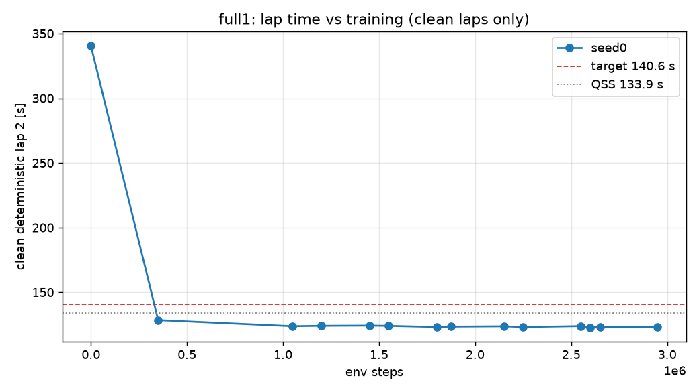

# D2 run `full1` — per-seed progress

Generated 2026-10-26 17:15 (local) by `scripts/seed_summary.py`. Done criterion (DECISIONS #12): clean deterministic flying lap 2 ≤ 140.6 s on all 3 seeds, plateau < 0.2 s over the last 20 %, seed std ≤ 0.2 s, ≥ 9/10 stochastic laps clean. Evaluations every 50k steps; "det." = deterministic policy, flying lap 2 after a run-in lap.

## seed0

- **State:** phase `rl`, state `running`, rollbacks 0, updated 2026-10-26T13:59:31+00:00 UTC
- **BC (instructive init):** epochs 18, best val NLL -2.426, gate lap 2 340.58 s (PASS, clean)
- event `unfreeze` at step 20000 (2026-10-26T09:10:11)
- event `det_regression` at step 50000 (2026-10-26T09:12:22)
- event `det_regression` at step 400000 (2026-10-26T09:38:23)
- event `det_regression` at step 1100000 (2026-10-26T10:52:30)
- event `det_regression` at step 1250000 (2026-10-26T11:03:57)
- event `det_regression` at step 1500000 (2026-10-26T11:23:15)
- event `det_regression` at step 1600000 (2026-10-26T11:31:36)
- event `det_regression` at step 1850000 (2026-10-26T11:53:00)
- event `wall_clock_limit` at step 1874232 (2026-10-26T11:54:54)
- event `resume` at step 1874232 (2026-10-26T11:55:31)
- event `det_regression` at step 1900000 (2026-10-26T11:57:47)
- event `det_regression` at step 2200000 (2026-10-26T12:22:37)
- event `det_regression` at step 2300000 (2026-10-26T12:33:25)
- event `det_regression` at step 2700000 (2026-10-26T13:21:27)
- event `det_regression` at step 3000000 (2026-10-26T13:59:28)
- **Best clean deterministic lap 2:** 122.85 s at step 2,600,000 (target ≤ 140.6 s, QSS 133.9 s)
- **Latest eval:** step 3,050,000; deterministic off_track; stochastic clean 10/10; train wall 3.63 h; 250 env steps/s

| step | det. result | lap 1 [s] | lap 2 [s] | stoch. clean | stoch. mean lap [s] | α | Q_min / MC | failure causes (training, cumulative) |
|---:|---|---:|---:|---:|---:|---:|---:|---|
| 0 | clean | 340.19 | 340.58 | 0/10 | — | 0.100 | 1.44 |  |
| 50,000 | off_track | — | — | 0/10 | — | 0.066 | 1.57 | stall 15, off_track 62, time_limit 5, wrong_way 6 |
| 100,000 | wrong_way | — | — | 0/10 | — | 0.072 | 1.23 | stall 21, off_track 114, time_limit 15, wrong_way 8 |
| 150,000 | wrong_way | — | — | 2/10 | 141.37 | 0.075 | 1.19 | stall 22, off_track 149, time_limit 30, wrong_way 12 |
| 200,000 | off_track | — | — | 4/10 | 136.18 | 0.081 | 1.15 | stall 24, off_track 174, time_limit 47, wrong_way 15 |
| 250,000 | off_track | — | — | 7/10 | 134.98 | 0.087 | 1.04 | stall 28, off_track 194, time_limit 69, wrong_way 17 |
| 300,000 | off_track | — | — | 4/10 | 133.73 | 0.087 | 1.06 | stall 30, off_track 214, time_limit 91, wrong_way 18 |
| 350,000 | clean | 128.74 | 128.46 | 6/10 | 131.23 | 0.084 | 1.06 | stall 30, off_track 224, time_limit 120, wrong_way 18 |
| 400,000 | off_track | — | — | 6/10 | 130.55 | 0.093 | 1.13 | stall 30, off_track 229, time_limit 149, wrong_way 19 |
| 450,000 | off_track | — | — | 6/10 | 130.18 | 0.086 | 1.07 | stall 30, off_track 232, time_limit 179, wrong_way 20 |
| 500,000 | off_track | — | — | 10/10 | 130.39 | 0.088 | 1.04 | stall 31, off_track 241, time_limit 208, wrong_way 20 |
| 550,000 | off_track | — | — | 10/10 | 128.82 | 0.087 | 1.05 | stall 31, off_track 249, time_limit 237, wrong_way 20 |
| 600,000 | off_track | — | — | 7/10 | 128.34 | 0.083 | 1.08 | stall 31, off_track 256, time_limit 268, wrong_way 21 |
| 650,000 | off_track | — | — | 5/10 | 128.02 | 0.081 | 1.07 | stall 31, off_track 264, time_limit 298, wrong_way 21 |
| 700,000 | off_track | — | — | 2/10 | 129.48 | 0.080 | 1.21 | stall 31, off_track 272, time_limit 326, wrong_way 22 |
| 750,000 | off_track | — | — | 9/10 | 127.58 | 0.078 | 1.05 | stall 31, off_track 275, time_limit 358, wrong_way 22 |
| 800,000 | off_track | — | — | 2/10 | 127.58 | 0.077 | 1.24 | stall 31, off_track 275, time_limit 390, wrong_way 23 |
| 850,000 | off_track | — | — | 10/10 | 126.94 | 0.073 | 1.04 | stall 31, off_track 276, time_limit 424, wrong_way 23 |
| 900,000 | off_track | — | — | 9/10 | 127.70 | 0.072 | 1.06 | stall 31, off_track 278, time_limit 456, wrong_way 23 |
| 950,000 | off_track | — | — | 9/10 | 127.03 | 0.070 | 1.03 | stall 31, off_track 282, time_limit 489, wrong_way 23 |
| 1,000,000 | off_track | — | — | 9/10 | 126.66 | 0.068 | 1.04 | stall 31, off_track 284, time_limit 520, wrong_way 24 |
| 1,050,000 | clean | 124.16 | 123.73 | 10/10 | 126.41 | 0.063 | 1.02 | stall 31, off_track 286, time_limit 551, wrong_way 24 |
| 1,100,000 | off_track | — | — | 9/10 | 126.23 | 0.058 | 1.05 | stall 31, off_track 288, time_limit 583, wrong_way 24 |
| 1,150,000 | off_track | — | — | 10/10 | 126.93 | 0.054 | 1.03 | stall 31, off_track 289, time_limit 617, wrong_way 24 |
| 1,200,000 | clean | 124.39 | 124.05 | 9/10 | 126.38 | 0.050 | 1.03 | stall 31, off_track 293, time_limit 646, wrong_way 25 |
| 1,250,000 | off_track | — | — | 9/10 | 126.55 | 0.048 | 1.03 | stall 31, off_track 301, time_limit 678, wrong_way 25 |
| 1,300,000 | off_track | — | — | 0/10 | — | 0.047 | 1.14 | stall 31, off_track 306, time_limit 707, wrong_way 27 |
| 1,350,000 | off_track | — | — | 6/10 | 125.85 | 0.046 | 1.06 | stall 31, off_track 310, time_limit 739, wrong_way 27 |
| 1,400,000 | off_track | — | — | 7/10 | 126.29 | 0.044 | 1.04 | stall 31, off_track 316, time_limit 769, wrong_way 28 |
| 1,450,000 | clean | 124.26 | 124.21 | 9/10 | 125.91 | 0.044 | 1.03 | stall 31, off_track 319, time_limit 801, wrong_way 28 |
| 1,500,000 | off_track | — | — | 7/10 | 125.85 | 0.044 | 1.06 | stall 31, off_track 325, time_limit 832, wrong_way 28 |
| 1,550,000 | clean | 124.18 | 124.01 | 9/10 | 125.69 | 0.043 | 1.04 | stall 31, off_track 328, time_limit 865, wrong_way 29 |
| 1,600,000 | off_track | — | — | 7/10 | 125.37 | 0.044 | 1.04 | stall 31, off_track 332, time_limit 895, wrong_way 29 |
| 1,650,000 | off_track | — | — | 8/10 | 125.27 | 0.041 | 1.03 | stall 31, off_track 337, time_limit 925, wrong_way 29 |
| 1,700,000 | off_track | — | — | 8/10 | 126.15 | 0.042 | 1.06 | stall 31, off_track 347, time_limit 956, wrong_way 29 |
| 1,750,000 | off_track | — | — | 9/10 | 126.01 | 0.043 | 1.03 | stall 31, off_track 357, time_limit 984, wrong_way 29 |
| 1,800,000 | clean | 123.35 | 123.12 | 10/10 | 125.09 | 0.044 | 1.03 | stall 31, off_track 359, time_limit 1017, wrong_way 29 |
| 1,850,000 | off_track | — | — | 7/10 | 124.78 | 0.041 | 1.05 | stall 31, off_track 362, time_limit 1049, wrong_way 29 |
| 1,874,232 | clean | 123.77 | 123.41 | 10/10 | 125.19 | 0.043 | 1.02 | stall 31, off_track 365, time_limit 1063, wrong_way 29 |
| 1,900,000 | off_track | 123.52 | — | 5/10 | 125.18 | 0.041 | 1.05 | time_limit 15, off_track 2 |
| 1,950,000 | off_track | — | — | 5/10 | 125.70 | 0.041 | 1.08 | time_limit 46, off_track 8 |
| 2,000,000 | off_track | — | — | 2/10 | 125.31 | 0.038 | 1.08 | time_limit 79, off_track 11 |
| 2,050,000 | off_track | — | — | 8/10 | 125.21 | 0.038 | 1.05 | time_limit 110, off_track 16 |
| 2,100,000 | off_track | — | — | 6/10 | 125.31 | 0.042 | 1.05 | time_limit 140, off_track 21 |
| 2,150,000 | clean | 123.87 | 123.67 | 8/10 | 125.41 | 0.040 | 1.06 | time_limit 172, off_track 24 |
| 2,200,000 | off_track | — | — | 9/10 | 125.03 | 0.039 | 1.04 | time_limit 205, off_track 25, wrong_way 1 |
| 2,250,000 | clean | 123.43 | 123.07 | 9/10 | 124.99 | 0.039 | 1.04 | time_limit 237, off_track 27, wrong_way 2 |
| 2,300,000 | off_track | — | — | 10/10 | 125.64 | 0.042 | 1.03 | time_limit 264, off_track 37, wrong_way 2 |
| 2,350,000 | off_track | — | — | 9/10 | 124.98 | 0.040 | 1.04 | time_limit 294, off_track 43, wrong_way 2 |
| 2,400,000 | off_track | — | — | 1/10 | 125.51 | 0.041 | 1.12 | time_limit 326, off_track 49, wrong_way 2 |
| 2,450,000 | off_track | — | — | 9/10 | 125.32 | 0.044 | 1.04 | time_limit 352, off_track 65, wrong_way 2 |
| 2,500,000 | off_track | — | — | 8/10 | 125.62 | 0.044 | 1.05 | time_limit 384, off_track 69, wrong_way 2 |
| 2,550,000 | clean | 124.07 | 123.82 | 10/10 | 125.39 | 0.044 | 1.04 | time_limit 412, off_track 76, wrong_way 2 |
| 2,600,000 | clean | 123.09 | 122.85 | 10/10 | 124.77 | 0.043 | 1.03 | time_limit 445, off_track 77, wrong_way 3 |
| 2,650,000 | clean | 123.70 | 123.24 | 8/10 | 125.28 | 0.044 | 1.06 | time_limit 476, off_track 82, wrong_way 3 |
| 2,700,000 | off_track | — | — | 8/10 | 125.15 | 0.043 | 1.04 | time_limit 506, off_track 86, wrong_way 3, stall 1 |
| 2,750,000 | off_track | — | — | 1/10 | 125.17 | 0.039 | 1.09 | time_limit 536, off_track 90, wrong_way 4, stall 1 |
| 2,800,000 | off_track | 123.47 | — | 10/10 | 124.86 | 0.042 | 1.03 | time_limit 567, off_track 94, wrong_way 4, stall 1 |
| 2,850,000 | off_track | 123.19 | — | 9/10 | 124.84 | 0.043 | 1.05 | time_limit 600, off_track 98, wrong_way 4, stall 1 |
| 2,900,000 | off_track | — | — | 9/10 | 124.68 | 0.041 | 1.04 | time_limit 629, off_track 107, wrong_way 4, stall 1 |
| 2,950,000 | clean | 123.70 | 123.30 | 10/10 | 125.26 | 0.042 | 1.02 | time_limit 658, off_track 110, wrong_way 4, stall 1 |
| 3,000,000 | off_track | — | — | 8/10 | 125.02 | 0.041 | 1.04 | time_limit 691, off_track 114, wrong_way 4, stall 1 |
| 3,050,000 | off_track | 123.24 | — | 10/10 | 124.98 | 0.041 | 1.03 | time_limit 721, off_track 119, wrong_way 4, stall 1 |

