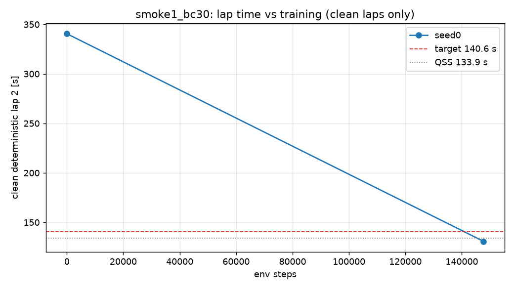

# D2 run `smoke1_bc30` — per-seed progress

Generated 2026-10-26 11:09 (local) by `scripts/seed_summary.py`. Done criterion (DECISIONS #12): clean deterministic flying lap 2 ≤ 140.6 s on all 3 seeds, plateau < 0.2 s over the last 20 %, seed std ≤ 0.2 s, ≥ 9/10 stochastic laps clean. Evaluations every 50k steps; "det." = deterministic policy, flying lap 2 after a run-in lap.

## seed0

- **State:** phase `done`, state `wall_clock_limit`, rollbacks 0, updated 2026-10-26T08:56:43+00:00 UTC
- **BC (instructive init):** epochs 18, best val NLL -2.426, gate lap 2 340.58 s (PASS, clean)
- event `unfreeze` at step 10000 (2026-10-26T06:27:17)
- event `det_regression` at step 25000 (2026-10-26T06:29:23)
- event `wall_clock_limit` at step 147704 (2026-10-26T06:47:42)
- event `resume` at step 147704 (2026-10-26T08:53:36)
- event `det_regression` at step 150000 (2026-10-26T08:53:58)
- event `wall_clock_limit` at step 175000 (2026-10-26T08:56:42)
- **Best clean deterministic lap 2:** 130.82 s at step 147,704 (target ≤ 140.6 s, QSS 133.9 s)
- **Latest eval:** step 175,000; deterministic off_track; stochastic clean 2/3; train wall 0.34 h; 159 env steps/s

| step | det. result | lap 1 [s] | lap 2 [s] | stoch. clean | stoch. mean lap [s] | α | Q_min / MC | failure causes (training, cumulative) |
|---:|---|---:|---:|---:|---:|---:|---:|---|
| 0 | clean | 340.19 | 340.58 | 0/3 | — | 0.100 | 0.69 |  |
| 25,000 | off_track | — | — | 0/3 | — | 0.054 | 1.39 | stall 9, wrong_way 6, off_track 53 |
| 50,000 | off_track | — | — | 0/3 | — | 0.072 | 2.02 | stall 9, wrong_way 7, off_track 77, time_limit 6 |
| 75,000 | off_track | — | — | 2/3 | 145.46 | 0.079 | 1.29 | stall 12, wrong_way 7, off_track 97, time_limit 12 |
| 100,000 | off_track | — | — | 0/3 | — | 0.069 | 1.39 | stall 12, wrong_way 7, off_track 112, time_limit 21 |
| 125,000 | off_track | — | — | 0/3 | — | 0.083 | 1.69 | stall 12, wrong_way 7, off_track 120, time_limit 35 |
| 147,704 | clean | 131.15 | 130.82 | 3/3 | 136.10 | 0.084 | 1.08 | stall 12, wrong_way 8, off_track 127, time_limit 46 |
| 150,000 | off_track | — | — | 3/3 | 133.37 | 0.084 | 1.10 | off_track 1 |
| 175,000 | off_track | — | — | 2/3 | 134.73 | 0.084 | 1.17 | off_track 13, time_limit 10 |

