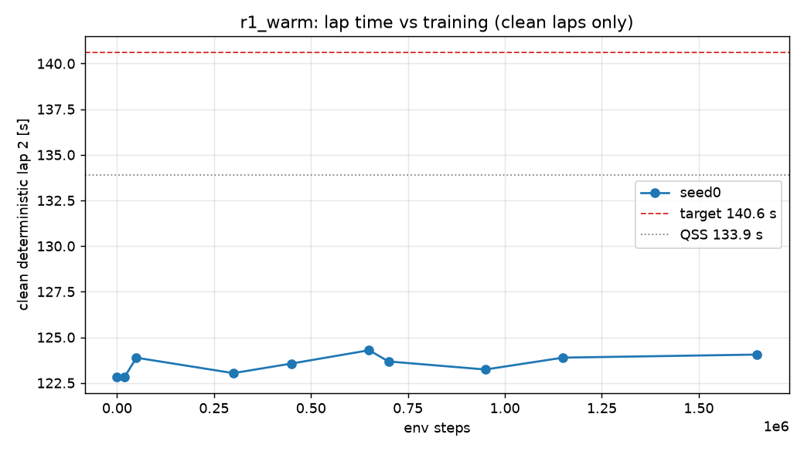

# D2 run `r1_warm` — per-seed progress

Generated 2026-10-27 12:13 (local) by `scripts/seed_summary.py`. Done criterion (DECISIONS #12): clean deterministic flying lap 2 ≤ 140.6 s on all 3 seeds, plateau < 0.2 s over the last 20 %, seed std ≤ 0.2 s, ≥ 9/10 stochastic laps clean. Evaluations every 50k steps; "det." = deterministic policy, flying lap 2 after a run-in lap.

## seed0

- **State:** phase `rl`, state `running`, rollbacks 1, updated 2026-10-27T10:09:14+00:00 UTC
- event `unfreeze` at step 20000 (2026-10-26T20:15:43)
- event `det_regression` at step 100000 (2026-10-26T20:22:45)
- event `rollback` at step 160000 (2026-10-26T20:27:35)
- event `det_regression` at step 350000 (2026-10-26T20:42:49)
- event `det_regression` at step 500000 (2026-10-26T20:55:11)
- event `det_regression` at step 750000 (2026-10-26T21:15:41)
- event `det_regression` at step 1000000 (2026-10-26T21:36:00)
- event `wall_clock_limit` at step 1082508 (2026-10-27T06:36:33)
- event `resume_refused` at step None (2026-10-27T08:03:43)
- event `resume` at step 1082508 (2026-10-27T08:04:56)
- event `det_regression` at step 1200000 (2026-10-27T08:14:14)
- event `det_regression` at step 1700000 (2026-10-27T08:50:17)
- **Best clean deterministic lap 2:** 122.85 s at step 0 (target ≤ 140.6 s, QSS 133.9 s)
- **Latest eval:** step 2,700,000; deterministic off_track; stochastic clean 10/10; train wall 3.22 h; 247 env steps/s

| step | det. result | lap 1 [s] | lap 2 [s] | stoch. clean | stoch. mean lap [s] | α | Q_min / MC | failure causes (training, cumulative) |
|---:|---|---:|---:|---:|---:|---:|---:|---|
| 0 | clean | 123.09 | 122.85 | 10/10 | 124.77 | 0.043 | 1.00 |  |
| 20,000 | clean | 123.09 | 122.85 | 10/10 | 124.77 | 0.043 | 1.00 | off_track 2, time_limit 11 |
| 50,000 | clean | 124.24 | 123.88 | 10/10 | 125.51 | 0.036 | 1.02 | off_track 3, time_limit 30 |
| 100,000 | off_track | — | — | 5/10 | 125.53 | 0.034 | 1.05 | off_track 8, time_limit 61, wrong_way 1 |
| 150,000 | off_track | — | — | 4/10 | 125.91 | 0.033 | 1.05 | off_track 18, time_limit 91, wrong_way 1 |
| 200,000 | off_track | — | — | 0/10 | — | 0.037 | 1.24 | off_track 22, time_limit 122, wrong_way 1, stall 1 |
| 250,000 | off_track | 124.53 | — | 1/10 | 125.67 | 0.035 | 1.08 | off_track 28, time_limit 152, wrong_way 2, stall 1 |
| 300,000 | clean | 124.38 | 123.04 | 10/10 | 125.30 | 0.038 | 1.02 | off_track 37, time_limit 180, wrong_way 2, stall 1 |
| 350,000 | off_track | — | — | 8/10 | 125.43 | 0.036 | 1.03 | off_track 47, time_limit 210, wrong_way 2, stall 1 |
| 400,000 | off_track | — | — | 9/10 | 125.18 | 0.040 | 1.02 | off_track 57, time_limit 238, wrong_way 2, stall 1 |
| 450,000 | clean | 123.99 | 123.56 | 3/10 | 125.42 | 0.036 | 1.06 | off_track 63, time_limit 269, wrong_way 2, stall 1 |
| 500,000 | off_track | — | — | 9/10 | 125.30 | 0.035 | 1.02 | off_track 70, time_limit 297, wrong_way 2, stall 1 |
| 550,000 | off_track | 123.03 | — | 10/10 | 125.05 | 0.035 | 1.02 | off_track 80, time_limit 328, wrong_way 2, stall 1 |
| 600,000 | off_track | — | — | 5/10 | 125.65 | 0.034 | 1.05 | off_track 89, time_limit 355, wrong_way 2, stall 1 |
| 650,000 | clean | 124.16 | 124.29 | 5/10 | 125.86 | 0.036 | 1.06 | off_track 93, time_limit 386, wrong_way 4, stall 1 |
| 700,000 | clean | 124.15 | 123.68 | 8/10 | 125.32 | 0.036 | 1.03 | off_track 99, time_limit 414, wrong_way 5, stall 1 |
| 750,000 | off_track | — | — | 5/10 | 125.33 | 0.036 | 1.05 | off_track 105, time_limit 445, wrong_way 5, stall 1 |
| 800,000 | off_track | — | — | 4/10 | 126.13 | 0.039 | 1.09 | off_track 111, time_limit 474, wrong_way 6, stall 1 |
| 850,000 | off_track | — | — | 5/10 | 125.97 | 0.035 | 1.05 | off_track 117, time_limit 506, wrong_way 6, stall 1 |
| 900,000 | off_track | — | — | 0/10 | — | 0.039 | 1.15 | off_track 129, time_limit 536, wrong_way 7, stall 2 |
| 950,000 | clean | 123.97 | 123.24 | 9/10 | 126.17 | 0.038 | 1.03 | off_track 139, time_limit 563, wrong_way 7, stall 2 |
| 1,000,000 | off_track | — | — | 0/10 | — | 0.038 | 1.11 | off_track 143, time_limit 593, wrong_way 7, stall 2 |
| 1,050,000 | off_track | — | — | 9/10 | 125.64 | 0.040 | 1.03 | off_track 152, time_limit 623, wrong_way 7, stall 2 |
| 1,082,508 | off_track | — | — | 8/10 | 125.61 | 0.042 | 1.04 | off_track 153, time_limit 645, wrong_way 7, stall 2 |
| 1,100,000 | off_track | — | — | 4/10 | 125.65 | 0.039 | 1.06 | time_limit 8, off_track 1 |
| 1,150,000 | clean | 124.35 | 123.89 | 8/10 | 125.67 | 0.041 | 1.03 | time_limit 39, off_track 4, stall 1, wrong_way 1 |
| 1,200,000 | off_track | — | — | 9/10 | 125.27 | 0.038 | 1.02 | time_limit 69, off_track 11, stall 2, wrong_way 1 |
| 1,250,000 | off_track | — | — | 2/10 | 125.73 | 0.037 | 1.11 | time_limit 101, off_track 15, stall 2, wrong_way 1 |
| 1,300,000 | off_track | — | — | 5/10 | 125.42 | 0.041 | 1.05 | time_limit 130, off_track 26, stall 2, wrong_way 1 |
| 1,350,000 | off_track | — | — | 7/10 | 125.71 | 0.042 | 1.04 | time_limit 160, off_track 31, stall 2, wrong_way 1 |
| 1,400,000 | off_track | 124.13 | — | 8/10 | 126.17 | 0.039 | 1.03 | time_limit 188, off_track 43, stall 3, wrong_way 2 |
| 1,450,000 | off_track | — | — | 8/10 | 125.48 | 0.039 | 1.03 | time_limit 220, off_track 45, stall 3, wrong_way 2 |
| 1,500,000 | off_track | — | — | 5/10 | 125.42 | 0.040 | 1.07 | time_limit 249, off_track 52, stall 3, wrong_way 2 |
| 1,550,000 | off_track | — | — | 3/10 | 125.82 | 0.041 | 1.08 | time_limit 276, off_track 65, stall 3, wrong_way 2 |
| 1,600,000 | off_track | — | — | 9/10 | 125.86 | 0.038 | 1.02 | time_limit 305, off_track 75, stall 3, wrong_way 2 |
| 1,650,000 | clean | 123.99 | 124.05 | 4/10 | 125.79 | 0.040 | 1.08 | time_limit 335, off_track 81, stall 3, wrong_way 3 |
| 1,700,000 | off_track | 123.95 | — | 2/10 | 125.55 | 0.041 | 1.07 | time_limit 362, off_track 94, stall 3, wrong_way 3 |
| 1,750,000 | off_track | — | — | 7/10 | 125.63 | 0.039 | 1.04 | time_limit 390, off_track 103, stall 3, wrong_way 3 |
| 1,800,000 | off_track | — | — | 6/10 | 126.00 | 0.042 | 1.04 | time_limit 420, off_track 109, stall 3, wrong_way 3 |
| 1,850,000 | off_track | — | — | 9/10 | 126.01 | 0.039 | 1.01 | time_limit 450, off_track 120, stall 3, wrong_way 4 |
| 1,900,000 | off_track | — | — | 8/10 | 125.84 | 0.039 | 1.02 | time_limit 480, off_track 124, stall 3, wrong_way 5 |
| 1,950,000 | off_track | — | — | 10/10 | 125.61 | 0.039 | 1.01 | time_limit 511, off_track 128, stall 4, wrong_way 6 |
| 2,000,000 | off_track | — | — | 3/10 | 125.71 | 0.039 | 1.09 | time_limit 540, off_track 137, stall 4, wrong_way 6 |
| 2,050,000 | off_track | — | — | 6/10 | 125.60 | 0.041 | 1.03 | time_limit 567, off_track 146, stall 4, wrong_way 6 |
| 2,100,000 | off_track | — | — | 5/10 | 125.26 | 0.040 | 1.04 | time_limit 600, off_track 151, stall 4, wrong_way 6 |
| 2,150,000 | off_track | — | — | 3/10 | 125.75 | 0.036 | 1.05 | time_limit 630, off_track 158, stall 4, wrong_way 6 |
| 2,200,000 | off_track | — | — | 5/10 | 125.67 | 0.039 | 1.07 | time_limit 662, off_track 165, stall 4, wrong_way 6 |
| 2,250,000 | off_track | — | — | 5/10 | 126.27 | 0.041 | 1.05 | time_limit 690, off_track 178, stall 4, wrong_way 6 |
| 2,300,000 | off_track | — | — | 8/10 | 126.81 | 0.040 | 1.03 | time_limit 719, off_track 193, stall 4, wrong_way 6 |
| 2,350,000 | off_track | — | — | 3/10 | 126.04 | 0.040 | 1.08 | time_limit 748, off_track 200, stall 4, wrong_way 6 |
| 2,400,000 | off_track | — | — | 4/10 | 125.77 | 0.040 | 1.06 | time_limit 777, off_track 207, stall 4, wrong_way 6 |
| 2,450,000 | off_track | — | — | 7/10 | 125.47 | 0.042 | 1.03 | time_limit 807, off_track 217, stall 4, wrong_way 6 |
| 2,500,000 | off_track | — | — | 9/10 | 125.71 | 0.042 | 1.01 | time_limit 838, off_track 221, stall 4, wrong_way 6 |
| 2,550,000 | off_track | — | — | 5/10 | 125.66 | 0.046 | 1.05 | time_limit 865, off_track 231, stall 5, wrong_way 6 |
| 2,600,000 | off_track | — | — | 5/10 | 125.22 | 0.045 | 1.05 | time_limit 898, off_track 234, stall 5, wrong_way 6 |
| 2,650,000 | off_track | — | — | 3/10 | 125.99 | 0.040 | 1.06 | time_limit 927, off_track 247, stall 5, wrong_way 6 |
| 2,700,000 | off_track | — | — | 10/10 | 125.79 | 0.041 | 1.01 | time_limit 955, off_track 255, stall 5, wrong_way 7 |

