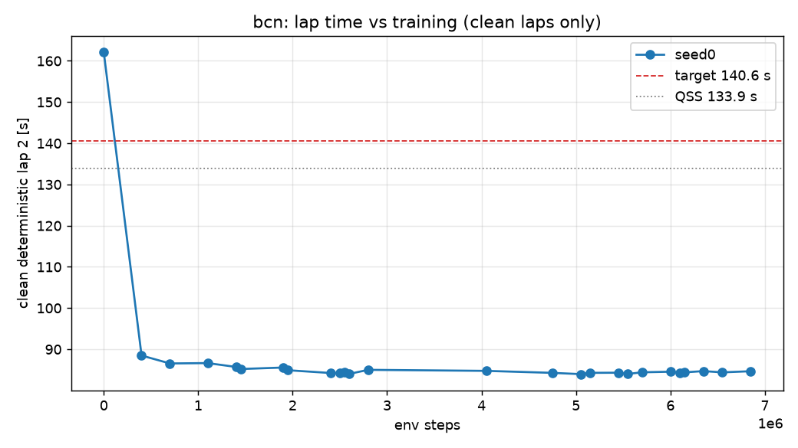

# D2 run `bcn` — per-seed progress

Generated 2026-11-01 04:34 (local) by `scripts/seed_summary.py`. Done criterion (DECISIONS #12): clean deterministic flying lap 2 ≤ 140.6 s on all 3 seeds, plateau < 0.2 s over the last 20 %, seed std ≤ 0.2 s, ≥ 9/10 stochastic laps clean. Evaluations every 50k steps; "det." = deterministic policy, flying lap 2 after a run-in lap.

## seed0

- **State:** phase `rl`, state `running`, rollbacks 1, updated 2026-11-01T02:31:29+00:00 UTC
- **BC (instructive init):** epochs 30, best val NLL -3.399, gate lap 2 162.09 s (PASS, clean)
- event `unfreeze` at step 20000 (2026-10-31T17:19:35)
- event `rollback` at step 30000 (2026-10-31T17:20:17)
- event `det_regression` at step 50000 (2026-10-31T17:21:56)
- event `det_regression` at step 450000 (2026-10-31T18:04:19)
- event `det_regression` at step 750000 (2026-10-31T18:30:25)
- event `det_regression` at step 1150000 (2026-10-31T19:04:07)
- event `det_regression` at step 1500000 (2026-10-31T19:43:30)
- event `det_regression` at step 2000000 (2026-10-31T20:23:43)
- event `det_regression` at step 2450000 (2026-10-31T20:56:57)
- event `det_regression` at step 2650000 (2026-10-31T21:11:36)
- event `det_regression` at step 2850000 (2026-10-31T21:25:36)
- event `det_regression` at step 4100000 (2026-10-31T23:08:51)
- event `det_regression` at step 4800000 (2026-10-31T23:57:14)
- event `det_regression` at step 5100000 (2026-11-01T00:17:51)
- event `det_regression` at step 5200000 (2026-11-01T00:24:39)
- event `det_regression` at step 5500000 (2026-11-01T00:45:18)
- event `det_regression` at step 5600000 (2026-11-01T00:52:17)
- event `det_regression` at step 5750000 (2026-11-01T01:02:40)
- event `det_regression` at step 6050000 (2026-11-01T01:23:15)
- event `det_regression` at step 6200000 (2026-11-01T01:33:29)
- event `det_regression` at step 6400000 (2026-11-01T01:46:54)
- event `det_regression` at step 6600000 (2026-11-01T02:00:35)
- event `det_regression` at step 6900000 (2026-11-01T02:21:04)
- **Best clean deterministic lap 2:** 83.97 s at step 5,050,000 (target ≤ 140.6 s, QSS 133.9 s)
- **Latest eval:** step 7,050,000; deterministic off_track; stochastic clean 10/10; train wall 8.56 h; 251 env steps/s

| step | det. result | lap 1 [s] | lap 2 [s] | stoch. clean | stoch. mean lap [s] | α | Q_min / MC | failure causes (training, cumulative) |
|---:|---|---:|---:|---:|---:|---:|---:|---|
| 0 | clean | 163.20 | 162.09 | 3/10 | 128.23 | 0.100 | 1.08 |  |
| 50,000 | off_track | — | — | 0/10 | — | 0.091 | 1.10 | off_track 171, time_limit 11, wrong_way 2, stall 11 |
| 100,000 | off_track | — | — | 0/10 | — | 0.104 | 1.34 | off_track 202, time_limit 31, wrong_way 2, stall 12 |
| 150,000 | off_track | — | — | 0/10 | — | 0.110 | 1.22 | off_track 232, time_limit 51, wrong_way 2, stall 12 |
| 200,000 | off_track | — | — | 1/10 | 92.72 | 0.120 | 1.22 | off_track 249, time_limit 74, wrong_way 3, stall 12 |
| 250,000 | off_track | — | — | 6/10 | 93.71 | 0.114 | 1.09 | off_track 270, time_limit 97, wrong_way 3, stall 12 |
| 300,000 | off_track | — | — | 10/10 | 93.09 | 0.092 | 1.01 | off_track 287, time_limit 121, wrong_way 3, stall 12 |
| 350,000 | off_track | — | — | 1/10 | 92.39 | 0.089 | 1.12 | off_track 302, time_limit 146, wrong_way 3, stall 12 |
| 400,000 | clean | 88.78 | 88.48 | 6/10 | 92.20 | 0.099 | 1.06 | off_track 318, time_limit 169, wrong_way 3, stall 12 |
| 450,000 | off_track | 87.40 | — | 9/10 | 90.93 | 0.092 | 1.00 | off_track 331, time_limit 196, wrong_way 3, stall 12 |
| 500,000 | off_track | — | — | 6/10 | 91.07 | 0.089 | 1.06 | off_track 340, time_limit 225, wrong_way 3, stall 12 |
| 550,000 | off_track | — | — | 8/10 | 91.99 | 0.087 | 1.05 | off_track 351, time_limit 252, wrong_way 3, stall 12 |
| 600,000 | off_track | — | — | 0/10 | — | 0.084 | 1.32 | off_track 363, time_limit 280, wrong_way 3, stall 12 |
| 650,000 | off_track | — | — | 8/10 | 90.04 | 0.083 | 1.02 | off_track 371, time_limit 306, wrong_way 4, stall 13 |
| 700,000 | clean | 86.96 | 86.55 | 10/10 | 89.74 | 0.089 | 1.02 | off_track 381, time_limit 333, wrong_way 5, stall 13 |
| 750,000 | off_track | 87.76 | — | 9/10 | 89.55 | 0.088 | 1.02 | off_track 390, time_limit 362, wrong_way 5, stall 13 |
| 800,000 | off_track | — | — | 9/10 | 90.35 | 0.090 | 1.03 | off_track 397, time_limit 391, wrong_way 5, stall 13 |
| 850,000 | off_track | — | — | 5/10 | 89.06 | 0.083 | 1.08 | off_track 407, time_limit 420, wrong_way 5, stall 13 |
| 900,000 | off_track | — | — | 9/10 | 89.45 | 0.080 | 1.02 | off_track 417, time_limit 450, wrong_way 6, stall 13 |
| 950,000 | off_track | — | — | 7/10 | 89.12 | 0.073 | 1.02 | off_track 422, time_limit 480, wrong_way 6, stall 13 |
| 1,000,000 | wrong_way | — | — | 6/10 | 88.90 | 0.071 | 1.05 | off_track 429, time_limit 510, wrong_way 7, stall 13 |
| 1,050,000 | off_track | — | — | 10/10 | 89.83 | 0.066 | 0.99 | off_track 431, time_limit 541, wrong_way 7, stall 13 |
| 1,100,000 | clean | 87.07 | 86.64 | 5/10 | 88.94 | 0.064 | 1.05 | off_track 436, time_limit 570, wrong_way 7, stall 13 |
| 1,150,000 | off_track | — | — | 9/10 | 89.58 | 0.063 | 1.02 | off_track 448, time_limit 597, wrong_way 8, stall 13 |
| 1,200,000 | off_track | — | — | 0/10 | — | 0.063 | 1.27 | off_track 452, time_limit 629, wrong_way 9, stall 13 |
| 1,250,000 | off_track | — | — | 7/10 | 88.59 | 0.061 | 1.04 | off_track 457, time_limit 659, wrong_way 10, stall 13 |
| 1,300,000 | off_track | 86.64 | — | 8/10 | 88.65 | 0.060 | 1.02 | off_track 468, time_limit 688, wrong_way 10, stall 13 |
| 1,350,000 | off_track | — | — | 1/10 | 87.40 | 0.062 | 1.24 | off_track 480, time_limit 718, wrong_way 10, stall 13 |
| 1,400,000 | clean | 86.12 | 85.71 | 9/10 | 88.53 | 0.057 | 1.01 | off_track 494, time_limit 746, wrong_way 10, stall 13 |
| 1,450,000 | clean | 85.96 | 85.21 | 8/10 | 87.94 | 0.062 | 1.02 | off_track 502, time_limit 774, wrong_way 10, stall 13 |
| 1,500,000 | off_track | — | — | 8/10 | 87.95 | 0.060 | 1.02 | off_track 514, time_limit 802, wrong_way 10, stall 13 |
| 1,550,000 | off_track | — | — | 10/10 | 88.27 | 0.064 | 1.01 | off_track 529, time_limit 828, wrong_way 10, stall 13 |
| 1,600,000 | off_track | — | — | 9/10 | 89.04 | 0.055 | 1.01 | off_track 543, time_limit 854, wrong_way 10, stall 13 |
| 1,650,000 | off_track | — | — | 8/10 | 87.45 | 0.062 | 1.03 | off_track 552, time_limit 883, wrong_way 10, stall 13 |
| 1,700,000 | off_track | — | — | 9/10 | 87.71 | 0.063 | 1.02 | off_track 567, time_limit 909, wrong_way 12, stall 13 |
| 1,750,000 | off_track | — | — | 5/10 | 87.87 | 0.060 | 1.05 | off_track 577, time_limit 938, wrong_way 12, stall 13 |
| 1,800,000 | off_track | 86.05 | — | 8/10 | 87.30 | 0.056 | 1.02 | off_track 580, time_limit 969, wrong_way 13, stall 13 |
| 1,850,000 | off_track | — | — | 0/10 | — | 0.056 | 1.46 | off_track 594, time_limit 996, wrong_way 13, stall 13 |
| 1,900,000 | clean | 85.88 | 85.56 | 8/10 | 87.72 | 0.055 | 1.02 | off_track 601, time_limit 1026, wrong_way 13, stall 13 |
| 1,950,000 | clean | 85.28 | 84.91 | 10/10 | 87.34 | 0.055 | 1.00 | off_track 608, time_limit 1056, wrong_way 13, stall 13 |
| 2,000,000 | off_track | — | — | 6/10 | 87.28 | 0.058 | 1.03 | off_track 616, time_limit 1084, wrong_way 13, stall 13 |
| 2,050,000 | off_track | — | — | 10/10 | 87.64 | 0.052 | 0.99 | off_track 624, time_limit 1113, wrong_way 13, stall 13 |
| 2,100,000 | off_track | 85.17 | — | 10/10 | 87.00 | 0.058 | 1.01 | off_track 638, time_limit 1140, wrong_way 13, stall 14 |
| 2,150,000 | off_track | — | — | 6/10 | 86.66 | 0.059 | 1.06 | off_track 647, time_limit 1167, wrong_way 13, stall 14 |
| 2,200,000 | off_track | — | — | 10/10 | 87.35 | 0.054 | 1.01 | off_track 652, time_limit 1200, wrong_way 13, stall 14 |
| 2,250,000 | off_track | — | — | 7/10 | 86.70 | 0.056 | 1.03 | off_track 659, time_limit 1229, wrong_way 13, stall 14 |
| 2,300,000 | off_track | — | — | 5/10 | 86.98 | 0.053 | 1.04 | off_track 667, time_limit 1259, wrong_way 13, stall 14 |
| 2,350,000 | off_track | — | — | 5/10 | 86.72 | 0.056 | 1.07 | off_track 674, time_limit 1291, wrong_way 13, stall 14 |
| 2,400,000 | clean | 84.66 | 84.24 | 9/10 | 87.40 | 0.058 | 1.02 | off_track 679, time_limit 1320, wrong_way 14, stall 14 |
| 2,450,000 | off_track | — | — | 8/10 | 86.60 | 0.054 | 1.04 | off_track 687, time_limit 1351, wrong_way 14, stall 14 |
| 2,500,000 | clean | 84.92 | 84.24 | 10/10 | 86.57 | 0.057 | 1.02 | off_track 693, time_limit 1382, wrong_way 14, stall 14 |
| 2,550,000 | clean | 84.66 | 84.51 | 8/10 | 86.73 | 0.056 | 1.03 | off_track 701, time_limit 1412, wrong_way 14, stall 14 |
| 2,600,000 | clean | 84.75 | 84.03 | 6/10 | 86.57 | 0.059 | 1.04 | off_track 708, time_limit 1442, wrong_way 14, stall 14 |
| 2,650,000 | off_track | — | — | 2/10 | 86.61 | 0.056 | 1.10 | off_track 717, time_limit 1470, wrong_way 14, stall 14 |
| 2,700,000 | off_track | 85.45 | — | 7/10 | 87.04 | 0.053 | 1.05 | off_track 730, time_limit 1495, wrong_way 14, stall 14 |
| 2,750,000 | off_track | — | — | 1/10 | 86.56 | 0.053 | 1.19 | off_track 742, time_limit 1523, wrong_way 14, stall 14 |
| 2,800,000 | clean | 85.87 | 85.01 | 9/10 | 87.25 | 0.049 | 1.02 | off_track 750, time_limit 1553, wrong_way 14, stall 14 |
| 2,850,000 | off_track | — | — | 8/10 | 86.72 | 0.052 | 1.04 | off_track 757, time_limit 1583, wrong_way 14, stall 14 |
| 2,900,000 | off_track | — | — | 4/10 | 86.91 | 0.053 | 1.08 | off_track 767, time_limit 1613, wrong_way 14, stall 14 |
| 2,950,000 | off_track | — | — | 5/10 | 86.74 | 0.059 | 1.10 | off_track 781, time_limit 1638, wrong_way 14, stall 15 |
| 3,000,000 | off_track | — | — | 2/10 | 87.00 | 0.059 | 1.13 | off_track 788, time_limit 1668, wrong_way 14, stall 15 |
| 3,050,000 | off_track | — | — | 3/10 | 86.52 | 0.054 | 1.09 | off_track 797, time_limit 1695, wrong_way 14, stall 15 |
| 3,100,000 | off_track | — | — | 7/10 | 87.32 | 0.056 | 1.06 | off_track 805, time_limit 1725, wrong_way 14, stall 15 |
| 3,150,000 | off_track | — | — | 4/10 | 86.85 | 0.056 | 1.09 | off_track 815, time_limit 1754, wrong_way 14, stall 15 |
| 3,200,000 | off_track | — | — | 3/10 | 86.81 | 0.058 | 1.06 | off_track 821, time_limit 1786, wrong_way 14, stall 16 |
| 3,250,000 | off_track | — | — | 8/10 | 87.05 | 0.062 | 1.04 | off_track 828, time_limit 1816, wrong_way 14, stall 16 |
| 3,300,000 | off_track | 84.82 | — | 9/10 | 86.50 | 0.060 | 1.02 | off_track 838, time_limit 1843, wrong_way 14, stall 16 |
| 3,350,000 | off_track | — | — | 5/10 | 86.79 | 0.061 | 1.07 | off_track 846, time_limit 1873, wrong_way 14, stall 16 |
| 3,400,000 | off_track | — | — | 9/10 | 87.26 | 0.058 | 1.02 | off_track 849, time_limit 1905, wrong_way 14, stall 16 |
| 3,450,000 | off_track | — | — | 7/10 | 86.51 | 0.055 | 1.04 | off_track 856, time_limit 1935, wrong_way 14, stall 16 |
| 3,500,000 | off_track | — | — | 9/10 | 86.94 | 0.055 | 1.02 | off_track 865, time_limit 1967, wrong_way 14, stall 16 |
| 3,550,000 | off_track | — | — | 5/10 | 87.22 | 0.058 | 1.07 | off_track 870, time_limit 1998, wrong_way 14, stall 16 |
| 3,600,000 | off_track | — | — | 5/10 | 87.06 | 0.053 | 1.05 | off_track 878, time_limit 2026, wrong_way 14, stall 16 |
| 3,650,000 | off_track | — | — | 10/10 | 86.49 | 0.063 | 1.02 | off_track 885, time_limit 2056, wrong_way 14, stall 16 |
| 3,700,000 | off_track | — | — | 8/10 | 86.64 | 0.058 | 1.04 | off_track 893, time_limit 2085, wrong_way 14, stall 16 |
| 3,750,000 | off_track | — | — | 1/10 | 86.84 | 0.058 | 1.13 | off_track 899, time_limit 2115, wrong_way 14, stall 16 |
| 3,800,000 | off_track | 85.70 | — | 9/10 | 87.31 | 0.059 | 1.03 | off_track 905, time_limit 2147, wrong_way 14, stall 16 |
| 3,850,000 | off_track | — | — | 9/10 | 86.85 | 0.059 | 1.03 | off_track 916, time_limit 2174, wrong_way 14, stall 16 |
| 3,900,000 | off_track | — | — | 5/10 | 87.35 | 0.060 | 1.10 | off_track 925, time_limit 2203, wrong_way 14, stall 16 |
| 3,950,000 | off_track | — | — | 5/10 | 86.67 | 0.064 | 1.12 | off_track 938, time_limit 2231, wrong_way 14, stall 16 |
| 4,000,000 | off_track | — | — | 9/10 | 86.67 | 0.056 | 1.02 | off_track 949, time_limit 2257, wrong_way 14, stall 16 |
| 4,050,000 | clean | 85.37 | 84.76 | 9/10 | 87.03 | 0.057 | 1.02 | off_track 951, time_limit 2290, wrong_way 14, stall 16 |
| 4,100,000 | off_track | 84.85 | — | 7/10 | 86.61 | 0.066 | 1.05 | off_track 959, time_limit 2320, wrong_way 14, stall 16 |
| 4,150,000 | off_track | — | — | 8/10 | 86.67 | 0.056 | 1.03 | off_track 961, time_limit 2353, wrong_way 14, stall 16 |
| 4,200,000 | off_track | — | — | 9/10 | 86.50 | 0.059 | 1.02 | off_track 967, time_limit 2383, wrong_way 14, stall 16 |
| 4,250,000 | off_track | — | — | 8/10 | 86.79 | 0.059 | 1.03 | off_track 974, time_limit 2414, wrong_way 14, stall 16 |
| 4,300,000 | off_track | — | — | 5/10 | 87.16 | 0.059 | 1.07 | off_track 982, time_limit 2444, wrong_way 14, stall 16 |
| 4,350,000 | off_track | — | — | 6/10 | 86.24 | 0.065 | 1.05 | off_track 987, time_limit 2475, wrong_way 14, stall 16 |
| 4,400,000 | off_track | — | — | 8/10 | 86.88 | 0.061 | 1.04 | off_track 994, time_limit 2504, wrong_way 14, stall 16 |
| 4,450,000 | off_track | — | — | 9/10 | 86.71 | 0.062 | 1.03 | off_track 1003, time_limit 2536, wrong_way 14, stall 16 |
| 4,500,000 | off_track | 84.33 | — | 5/10 | 85.99 | 0.066 | 1.07 | off_track 1019, time_limit 2563, wrong_way 14, stall 16 |
| 4,550,000 | off_track | — | — | 9/10 | 86.60 | 0.065 | 1.04 | off_track 1028, time_limit 2592, wrong_way 14, stall 16 |
| 4,600,000 | off_track | — | — | 8/10 | 86.07 | 0.065 | 1.05 | off_track 1034, time_limit 2622, wrong_way 14, stall 17 |
| 4,650,000 | off_track | — | — | 8/10 | 86.64 | 0.067 | 1.04 | off_track 1038, time_limit 2653, wrong_way 15, stall 17 |
| 4,700,000 | off_track | 85.02 | — | 8/10 | 86.63 | 0.063 | 1.05 | off_track 1043, time_limit 2686, wrong_way 15, stall 17 |
| 4,750,000 | clean | 84.88 | 84.27 | 6/10 | 86.66 | 0.059 | 1.05 | off_track 1046, time_limit 2717, wrong_way 15, stall 18 |
| 4,800,000 | off_track | — | — | 6/10 | 87.12 | 0.055 | 1.05 | off_track 1053, time_limit 2747, wrong_way 15, stall 18 |
| 4,850,000 | off_track | — | — | 0/10 | — | 0.056 | 1.09 | off_track 1064, time_limit 2774, wrong_way 15, stall 18 |
| 4,900,000 | off_track | — | — | 4/10 | 87.06 | 0.061 | 1.07 | off_track 1069, time_limit 2806, wrong_way 15, stall 18 |
| 4,950,000 | off_track | 85.01 | — | 6/10 | 86.39 | 0.057 | 1.05 | off_track 1076, time_limit 2835, wrong_way 15, stall 18 |
| 5,000,000 | off_track | — | — | 8/10 | 86.20 | 0.063 | 1.04 | off_track 1093, time_limit 2862, wrong_way 15, stall 18 |
| 5,050,000 | clean | 84.42 | 83.97 | 10/10 | 85.99 | 0.063 | 1.02 | off_track 1104, time_limit 2889, wrong_way 15, stall 18 |
| 5,100,000 | off_track | — | — | 5/10 | 86.59 | 0.059 | 1.09 | off_track 1109, time_limit 2919, wrong_way 15, stall 18 |
| 5,150,000 | clean | 85.21 | 84.28 | 6/10 | 86.36 | 0.057 | 1.07 | off_track 1112, time_limit 2954, wrong_way 15, stall 18 |
| 5,200,000 | off_track | — | — | 3/10 | 86.50 | 0.059 | 1.14 | off_track 1115, time_limit 2985, wrong_way 15, stall 18 |
| 5,250,000 | off_track | — | — | 1/10 | 87.12 | 0.059 | 1.17 | off_track 1127, time_limit 3012, wrong_way 15, stall 18 |
| 5,300,000 | off_track | — | — | 3/10 | 87.01 | 0.060 | 1.10 | off_track 1146, time_limit 3038, wrong_way 15, stall 18 |
| 5,350,000 | off_track | — | — | 4/10 | 86.70 | 0.063 | 1.08 | off_track 1150, time_limit 3069, wrong_way 15, stall 18 |
| 5,400,000 | off_track | — | — | 8/10 | 86.51 | 0.063 | 1.05 | off_track 1158, time_limit 3097, wrong_way 15, stall 18 |
| 5,450,000 | clean | 85.10 | 84.31 | 6/10 | 86.21 | 0.057 | 1.04 | off_track 1162, time_limit 3128, wrong_way 15, stall 18 |
| 5,500,000 | off_track | — | — | 3/10 | 86.39 | 0.061 | 1.08 | off_track 1172, time_limit 3158, wrong_way 15, stall 18 |
| 5,550,000 | clean | 84.49 | 84.02 | 9/10 | 86.13 | 0.062 | 1.03 | off_track 1185, time_limit 3185, wrong_way 15, stall 18 |
| 5,600,000 | off_track | — | — | 8/10 | 86.41 | 0.059 | 1.03 | off_track 1195, time_limit 3212, wrong_way 15, stall 18 |
| 5,650,000 | off_track | 85.09 | — | 6/10 | 86.61 | 0.064 | 1.07 | off_track 1204, time_limit 3240, wrong_way 15, stall 18 |
| 5,700,000 | clean | 84.73 | 84.41 | 10/10 | 86.76 | 0.064 | 1.03 | off_track 1217, time_limit 3268, wrong_way 15, stall 18 |
| 5,750,000 | off_track | — | — | 10/10 | 86.35 | 0.072 | 1.02 | off_track 1228, time_limit 3296, wrong_way 15, stall 18 |
| 5,800,000 | off_track | 84.78 | — | 8/10 | 86.56 | 0.069 | 1.04 | off_track 1235, time_limit 3327, wrong_way 15, stall 18 |
| 5,850,000 | off_track | — | — | 5/10 | 86.55 | 0.063 | 1.07 | off_track 1244, time_limit 3358, wrong_way 15, stall 18 |
| 5,900,000 | off_track | 84.55 | — | 10/10 | 86.66 | 0.067 | 1.02 | off_track 1253, time_limit 3387, wrong_way 15, stall 18 |
| 5,950,000 | off_track | — | — | 8/10 | 86.20 | 0.065 | 1.03 | off_track 1270, time_limit 3413, wrong_way 15, stall 18 |
| 6,000,000 | clean | 84.86 | 84.55 | 9/10 | 86.56 | 0.072 | 1.04 | off_track 1275, time_limit 3443, wrong_way 16, stall 18 |
| 6,050,000 | off_track | — | — | 6/10 | 86.50 | 0.071 | 1.07 | off_track 1286, time_limit 3473, wrong_way 16, stall 18 |
| 6,100,000 | clean | 84.76 | 84.31 | 5/10 | 86.60 | 0.068 | 1.07 | off_track 1293, time_limit 3502, wrong_way 16, stall 18 |
| 6,150,000 | clean | 84.72 | 84.40 | 9/10 | 86.84 | 0.067 | 1.03 | off_track 1299, time_limit 3532, wrong_way 16, stall 18 |
| 6,200,000 | off_track | 84.62 | — | 10/10 | 86.56 | 0.068 | 1.02 | off_track 1311, time_limit 3557, wrong_way 16, stall 18 |
| 6,250,000 | off_track | — | — | 1/10 | 86.64 | 0.073 | 1.26 | off_track 1315, time_limit 3590, wrong_way 16, stall 18 |
| 6,300,000 | off_track | — | — | 5/10 | 86.15 | 0.070 | 1.07 | off_track 1319, time_limit 3622, wrong_way 16, stall 18 |
| 6,350,000 | clean | 85.05 | 84.70 | 9/10 | 86.44 | 0.070 | 1.03 | off_track 1329, time_limit 3652, wrong_way 16, stall 18 |
| 6,400,000 | off_track | — | — | 7/10 | 86.56 | 0.066 | 1.06 | off_track 1332, time_limit 3684, wrong_way 16, stall 18 |
| 6,450,000 | off_track | — | — | 8/10 | 86.67 | 0.068 | 1.04 | off_track 1341, time_limit 3714, wrong_way 16, stall 18 |
| 6,500,000 | off_track | — | — | 9/10 | 86.52 | 0.063 | 1.03 | off_track 1346, time_limit 3746, wrong_way 16, stall 18 |
| 6,550,000 | clean | 85.01 | 84.39 | 10/10 | 86.65 | 0.062 | 1.02 | off_track 1352, time_limit 3777, wrong_way 16, stall 18 |
| 6,600,000 | off_track | — | — | 8/10 | 86.56 | 0.064 | 1.04 | off_track 1362, time_limit 3806, wrong_way 16, stall 18 |
| 6,650,000 | off_track | — | — | 8/10 | 86.24 | 0.064 | 1.05 | off_track 1363, time_limit 3838, wrong_way 16, stall 18 |
| 6,700,000 | off_track | — | — | 9/10 | 86.53 | 0.068 | 1.03 | off_track 1376, time_limit 3866, wrong_way 16, stall 18 |
| 6,750,000 | off_track | — | — | 9/10 | 86.50 | 0.067 | 1.03 | off_track 1380, time_limit 3897, wrong_way 16, stall 18 |
| 6,800,000 | off_track | — | — | 8/10 | 86.70 | 0.066 | 1.04 | off_track 1383, time_limit 3929, wrong_way 16, stall 18 |
| 6,850,000 | clean | 84.98 | 84.67 | 9/10 | 86.57 | 0.061 | 1.03 | off_track 1394, time_limit 3956, wrong_way 16, stall 18 |
| 6,900,000 | off_track | — | — | 10/10 | 86.80 | 0.065 | 1.03 | off_track 1401, time_limit 3986, wrong_way 16, stall 18 |
| 6,950,000 | off_track | — | — | 6/10 | 86.56 | 0.061 | 1.07 | off_track 1404, time_limit 4018, wrong_way 16, stall 18 |
| 7,000,000 | off_track | — | — | 2/10 | 86.25 | 0.064 | 1.10 | off_track 1407, time_limit 4050, wrong_way 16, stall 18 |
| 7,050,000 | off_track | — | — | 10/10 | 86.46 | 0.053 | 1.01 | off_track 1415, time_limit 4080, wrong_way 16, stall 18 |

