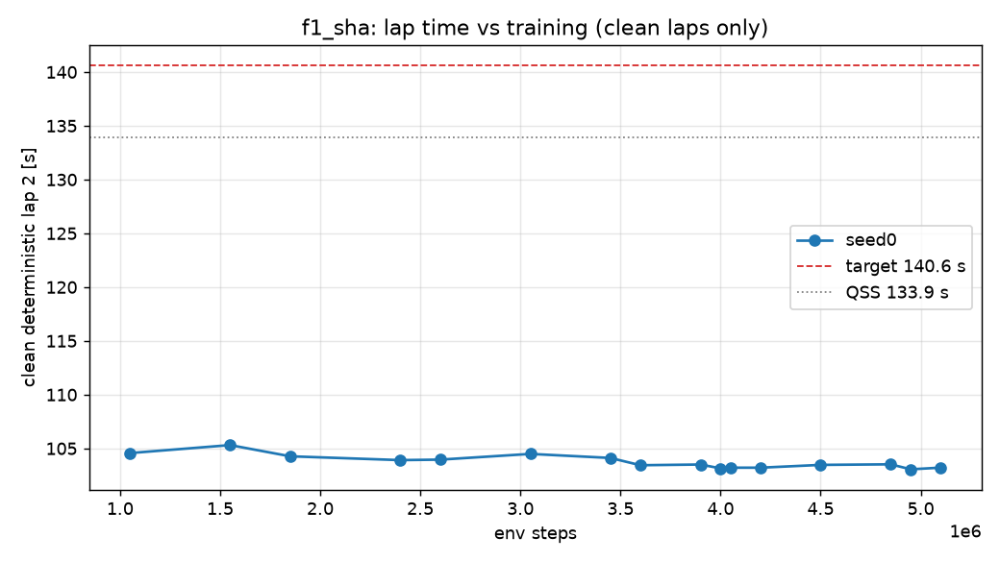

# D2 run `f1_sha` — per-seed progress

Generated 2026-11-03 23:55 (local) by `scripts/seed_summary.py`. Done criterion (DECISIONS #12): clean deterministic flying lap 2 ≤ 140.6 s on all 3 seeds, plateau < 0.2 s over the last 20 %, seed std ≤ 0.2 s, ≥ 9/10 stochastic laps clean. Evaluations every 50k steps; "det." = deterministic policy, flying lap 2 after a run-in lap.

## seed0

- **State:** phase `rl`, state `running`, rollbacks 1, updated 2026-11-03T21:55:22+00:00 UTC
- **BC (instructive init):** epochs 30, best val NLL -2.681, gate lap 2 — s (FAIL: off_track)
- event `unfreeze` at step 20000 (2026-11-03T11:48:48)
- event `rollback` at step 40000 (2026-11-03T11:50:08)
- event `det_regression` at step 1100000 (2026-11-03T13:04:53)
- event `det_regression` at step 1600000 (2026-11-03T13:40:40)
- event `det_regression` at step 1900000 (2026-11-03T14:01:53)
- event `det_regression` at step 2450000 (2026-11-03T17:43:32)
- event `det_regression` at step 2650000 (2026-11-03T17:58:28)
- event `det_regression` at step 3100000 (2026-11-03T18:33:36)
- event `det_regression` at step 3500000 (2026-11-03T19:04:47)
- event `det_regression` at step 3650000 (2026-11-03T19:16:28)
- event `det_regression` at step 3950000 (2026-11-03T19:43:44)
- event `det_regression` at step 4100000 (2026-11-03T20:01:14)
- event `det_regression` at step 4250000 (2026-11-03T20:22:26)
- event `det_regression` at step 4550000 (2026-11-03T20:49:06)
- event `det_regression` at step 4900000 (2026-11-03T21:16:00)
- event `det_regression` at step 5000000 (2026-11-03T21:24:02)
- event `det_regression` at step 5150000 (2026-11-03T21:35:25)
- **Best clean deterministic lap 2:** 103.06 s at step 4,950,000 (target ≤ 140.6 s, QSS 133.9 s)
- **Latest eval:** step 5,400,000; deterministic off_track; stochastic clean 7/10; train wall 6.55 h; 204 env steps/s

| step | det. result | lap 1 [s] | lap 2 [s] | stoch. clean | stoch. mean lap [s] | α | Q_min / MC | failure causes (training, cumulative) |
|---:|---|---:|---:|---:|---:|---:|---:|---|
| 0 | off_track | — | — | 0/10 | — | 0.100 | 1.08 |  |
| 50,000 | off_track | — | — | 0/10 | — | 0.065 | 1.89 | off_track 103, time_limit 7, wrong_way 3, stall 4 |
| 100,000 | off_track | — | — | 0/10 | — | 0.072 | 1.14 | off_track 151, time_limit 21, wrong_way 3, stall 5 |
| 150,000 | off_track | — | — | 0/10 | — | 0.072 | 1.04 | off_track 186, time_limit 38, wrong_way 4, stall 6 |
| 200,000 | off_track | — | — | 2/10 | 115.47 | 0.081 | 1.05 | off_track 218, time_limit 55, wrong_way 4, stall 8 |
| 250,000 | off_track | — | — | 0/10 | — | 0.078 | 1.10 | off_track 245, time_limit 75, wrong_way 4, stall 9 |
| 300,000 | off_track | — | — | 7/10 | 112.57 | 0.074 | 1.00 | off_track 270, time_limit 96, wrong_way 5, stall 9 |
| 350,000 | off_track | — | — | 0/10 | — | 0.072 | 1.14 | off_track 287, time_limit 119, wrong_way 5, stall 9 |
| 400,000 | off_track | — | — | 0/10 | — | 0.076 | 1.09 | off_track 311, time_limit 140, wrong_way 5, stall 9 |
| 450,000 | off_track | — | — | 2/10 | 109.93 | 0.069 | 1.06 | off_track 318, time_limit 168, wrong_way 5, stall 9 |
| 500,000 | off_track | — | — | 1/10 | 110.05 | 0.072 | 1.11 | off_track 345, time_limit 188, wrong_way 5, stall 9 |
| 550,000 | off_track | 106.89 | — | 0/10 | — | 0.069 | 1.05 | off_track 368, time_limit 212, wrong_way 5, stall 9 |
| 600,000 | off_track | — | — | 0/10 | — | 0.067 | 1.15 | off_track 389, time_limit 234, wrong_way 5, stall 9 |
| 650,000 | off_track | — | — | 4/10 | 109.73 | 0.072 | 1.05 | off_track 400, time_limit 260, wrong_way 6, stall 9 |
| 700,000 | off_track | — | — | 2/10 | 108.37 | 0.069 | 1.13 | off_track 405, time_limit 292, wrong_way 6, stall 9 |
| 750,000 | off_track | — | — | 4/10 | 109.07 | 0.070 | 1.09 | off_track 416, time_limit 319, wrong_way 6, stall 9 |
| 800,000 | off_track | — | — | 6/10 | 108.73 | 0.065 | 1.02 | off_track 422, time_limit 348, wrong_way 7, stall 9 |
| 850,000 | off_track | — | — | 2/10 | 108.18 | 0.064 | 1.04 | off_track 441, time_limit 372, wrong_way 7, stall 9 |
| 900,000 | off_track | — | — | 2/10 | 107.85 | 0.066 | 1.07 | off_track 450, time_limit 401, wrong_way 7, stall 9 |
| 950,000 | off_track | — | — | 8/10 | 107.69 | 0.059 | 1.02 | off_track 461, time_limit 429, wrong_way 7, stall 9 |
| 1,000,000 | off_track | — | — | 7/10 | 107.77 | 0.060 | 1.02 | off_track 471, time_limit 458, wrong_way 7, stall 9 |
| 1,050,000 | clean | 105.05 | 104.57 | 8/10 | 107.24 | 0.056 | 1.01 | off_track 484, time_limit 484, wrong_way 7, stall 9 |
| 1,100,000 | off_track | — | — | 8/10 | 107.39 | 0.050 | 1.00 | off_track 489, time_limit 514, wrong_way 7, stall 9 |
| 1,150,000 | off_track | — | — | 7/10 | 107.48 | 0.049 | 1.02 | off_track 506, time_limit 539, wrong_way 7, stall 10 |
| 1,200,000 | off_track | — | — | 3/10 | 107.10 | 0.050 | 1.10 | off_track 520, time_limit 567, wrong_way 7, stall 10 |
| 1,250,000 | off_track | 105.98 | — | 9/10 | 107.71 | 0.045 | 1.01 | off_track 530, time_limit 596, wrong_way 7, stall 10 |
| 1,300,000 | off_track | — | — | 5/10 | 107.48 | 0.042 | 1.04 | off_track 536, time_limit 625, wrong_way 7, stall 10 |
| 1,350,000 | off_track | — | — | 10/10 | 107.54 | 0.042 | 1.00 | off_track 553, time_limit 651, wrong_way 7, stall 10 |
| 1,400,000 | off_track | — | — | 4/10 | 108.07 | 0.044 | 1.05 | off_track 560, time_limit 681, wrong_way 8, stall 10 |
| 1,450,000 | off_track | — | — | 1/10 | 107.63 | 0.041 | 1.05 | off_track 569, time_limit 711, wrong_way 8, stall 10 |
| 1,500,000 | off_track | — | — | 7/10 | 106.88 | 0.047 | 1.02 | off_track 581, time_limit 738, wrong_way 8, stall 10 |
| 1,550,000 | clean | 106.03 | 105.31 | 8/10 | 107.88 | 0.045 | 1.02 | off_track 586, time_limit 768, wrong_way 8, stall 10 |
| 1,600,000 | off_track | — | — | 6/10 | 107.21 | 0.044 | 1.02 | off_track 604, time_limit 791, wrong_way 9, stall 10 |
| 1,650,000 | off_track | — | — | 2/10 | 107.68 | 0.045 | 1.08 | off_track 614, time_limit 819, wrong_way 9, stall 10 |
| 1,700,000 | off_track | — | — | 2/10 | 106.95 | 0.045 | 1.06 | off_track 626, time_limit 847, wrong_way 9, stall 10 |
| 1,750,000 | off_track | — | — | 1/10 | 106.52 | 0.045 | 1.10 | off_track 639, time_limit 873, wrong_way 9, stall 10 |
| 1,800,000 | off_track | — | — | 0/10 | — | 0.043 | 1.07 | off_track 647, time_limit 902, wrong_way 9, stall 10 |
| 1,850,000 | clean | 104.42 | 104.27 | 5/10 | 106.62 | 0.045 | 1.03 | off_track 656, time_limit 929, wrong_way 9, stall 10 |
| 1,900,000 | off_track | — | — | 4/10 | 107.17 | 0.043 | 1.03 | off_track 676, time_limit 953, wrong_way 9, stall 10 |
| 1,950,000 | off_track | — | — | 0/10 | — | 0.047 | 1.27 | off_track 689, time_limit 980, wrong_way 9, stall 11 |
| 2,000,000 | off_track | 104.83 | — | 9/10 | 107.27 | 0.043 | 1.00 | off_track 693, time_limit 1010, wrong_way 9, stall 11 |
| 2,050,000 | off_track | 104.57 | — | 4/10 | 107.11 | 0.046 | 1.04 | off_track 704, time_limit 1039, wrong_way 9, stall 11 |
| 2,100,000 | off_track | — | — | 5/10 | 107.12 | 0.045 | 1.04 | off_track 717, time_limit 1067, wrong_way 9, stall 11 |
| 2,150,000 | off_track | — | — | 3/10 | 107.37 | 0.045 | 1.06 | off_track 731, time_limit 1091, wrong_way 9, stall 11 |
| 2,200,000 | off_track | — | — | 7/10 | 107.20 | 0.047 | 1.04 | off_track 739, time_limit 1120, wrong_way 10, stall 11 |
| 2,250,000 | off_track | — | — | 8/10 | 106.43 | 0.042 | 1.00 | off_track 750, time_limit 1148, wrong_way 10, stall 11 |
| 2,300,000 | off_track | — | — | 8/10 | 106.26 | 0.044 | 1.01 | off_track 759, time_limit 1177, wrong_way 10, stall 11 |
| 2,350,000 | off_track | — | — | 2/10 | 106.44 | 0.046 | 1.09 | off_track 764, time_limit 1208, wrong_way 10, stall 11 |
| 2,400,000 | clean | 104.39 | 103.91 | 8/10 | 106.48 | 0.043 | 1.01 | off_track 782, time_limit 1233, wrong_way 10, stall 11 |
| 2,450,000 | off_track | — | — | 5/10 | 105.72 | 0.045 | 1.03 | off_track 790, time_limit 1262, wrong_way 10, stall 11 |
| 2,500,000 | off_track | — | — | 1/10 | 105.77 | 0.046 | 1.22 | off_track 794, time_limit 1293, wrong_way 10, stall 11 |
| 2,550,000 | off_track | — | — | 5/10 | 105.44 | 0.049 | 1.05 | off_track 806, time_limit 1321, wrong_way 10, stall 11 |
| 2,600,000 | clean | 104.31 | 103.96 | 8/10 | 106.10 | 0.046 | 1.02 | off_track 811, time_limit 1352, wrong_way 10, stall 11 |
| 2,650,000 | off_track | — | — | 4/10 | 105.63 | 0.045 | 1.03 | off_track 820, time_limit 1383, wrong_way 10, stall 11 |
| 2,700,000 | off_track | — | — | 2/10 | 106.74 | 0.040 | 1.09 | off_track 827, time_limit 1413, wrong_way 10, stall 11 |
| 2,750,000 | off_track | — | — | 0/10 | — | 0.043 | 1.19 | off_track 840, time_limit 1438, wrong_way 10, stall 11 |
| 2,800,000 | off_track | — | — | 6/10 | 105.97 | 0.046 | 1.05 | off_track 849, time_limit 1468, wrong_way 10, stall 11 |
| 2,850,000 | off_track | — | — | 5/10 | 106.23 | 0.044 | 1.04 | off_track 861, time_limit 1496, wrong_way 10, stall 11 |
| 2,900,000 | off_track | — | — | 8/10 | 106.08 | 0.038 | 1.01 | off_track 865, time_limit 1527, wrong_way 10, stall 11 |
| 2,950,000 | off_track | — | — | 2/10 | 106.32 | 0.043 | 1.10 | off_track 875, time_limit 1554, wrong_way 10, stall 11 |
| 3,000,000 | off_track | — | — | 3/10 | 105.90 | 0.041 | 1.09 | off_track 890, time_limit 1582, wrong_way 10, stall 11 |
| 3,050,000 | clean | 105.02 | 104.49 | 1/10 | 106.91 | 0.043 | 1.09 | off_track 910, time_limit 1604, wrong_way 10, stall 11 |
| 3,100,000 | off_track | — | — | 3/10 | 106.62 | 0.040 | 1.08 | off_track 918, time_limit 1634, wrong_way 10, stall 11 |
| 3,150,000 | off_track | — | — | 4/10 | 105.90 | 0.043 | 1.07 | off_track 931, time_limit 1660, wrong_way 10, stall 11 |
| 3,200,000 | off_track | — | — | 9/10 | 105.95 | 0.044 | 1.01 | off_track 938, time_limit 1689, wrong_way 10, stall 11 |
| 3,250,000 | off_track | — | — | 3/10 | 105.47 | 0.041 | 1.08 | off_track 947, time_limit 1718, wrong_way 10, stall 11 |
| 3,300,000 | off_track | — | — | 3/10 | 105.88 | 0.043 | 1.06 | off_track 959, time_limit 1745, wrong_way 10, stall 11 |
| 3,350,000 | off_track | — | — | 2/10 | 105.27 | 0.046 | 1.08 | off_track 975, time_limit 1773, wrong_way 10, stall 11 |
| 3,400,000 | off_track | — | — | 8/10 | 105.72 | 0.047 | 1.02 | off_track 989, time_limit 1800, wrong_way 10, stall 11 |
| 3,450,000 | clean | 104.73 | 104.11 | 8/10 | 106.48 | 0.045 | 1.02 | off_track 1008, time_limit 1823, wrong_way 10, stall 11 |
| 3,500,000 | off_track | — | — | 7/10 | 108.15 | 0.044 | 1.03 | off_track 1022, time_limit 1850, wrong_way 10, stall 11 |
| 3,550,000 | off_track | — | — | 5/10 | 105.85 | 0.046 | 1.03 | off_track 1037, time_limit 1876, wrong_way 10, stall 11 |
| 3,600,000 | clean | 103.73 | 103.44 | 8/10 | 106.22 | 0.045 | 1.01 | off_track 1042, time_limit 1909, wrong_way 10, stall 11 |
| 3,650,000 | off_track | — | — | 1/10 | 105.49 | 0.049 | 1.09 | off_track 1048, time_limit 1940, wrong_way 10, stall 11 |
| 3,700,000 | off_track | — | — | 4/10 | 105.99 | 0.047 | 1.05 | off_track 1057, time_limit 1970, wrong_way 10, stall 11 |
| 3,750,000 | off_track | — | — | 5/10 | 105.56 | 0.046 | 1.04 | off_track 1068, time_limit 1995, wrong_way 11, stall 11 |
| 3,800,000 | off_track | — | — | 10/10 | 105.45 | 0.046 | 1.00 | off_track 1082, time_limit 2022, wrong_way 12, stall 11 |
| 3,850,000 | off_track | — | — | 9/10 | 105.49 | 0.047 | 1.00 | off_track 1089, time_limit 2049, wrong_way 12, stall 11 |
| 3,900,000 | clean | 103.61 | 103.50 | 7/10 | 105.62 | 0.048 | 1.02 | off_track 1097, time_limit 2081, wrong_way 12, stall 11 |
| 3,950,000 | off_track | — | — | 8/10 | 105.97 | 0.048 | 1.02 | off_track 1106, time_limit 2109, wrong_way 12, stall 11 |
| 4,000,000 | clean | 103.47 | 103.14 | 8/10 | 105.71 | 0.045 | 1.01 | off_track 1118, time_limit 2135, wrong_way 13, stall 11 |
| 4,050,000 | clean | 103.42 | 103.21 | 8/10 | 105.63 | 0.048 | 1.02 | off_track 1130, time_limit 2162, wrong_way 13, stall 11 |
| 4,100,000 | off_track | — | — | 5/10 | 105.67 | 0.049 | 1.05 | off_track 1138, time_limit 2192, wrong_way 13, stall 11 |
| 4,150,000 | off_track | — | — | 8/10 | 105.65 | 0.044 | 1.01 | off_track 1156, time_limit 2215, wrong_way 14, stall 11 |
| 4,200,000 | clean | 103.52 | 103.21 | 9/10 | 105.58 | 0.048 | 1.01 | off_track 1165, time_limit 2245, wrong_way 14, stall 11 |
| 4,250,000 | off_track | — | — | 0/10 | — | 0.044 | 1.11 | off_track 1167, time_limit 2276, wrong_way 14, stall 11 |
| 4,300,000 | off_track | — | — | 7/10 | 105.19 | 0.046 | 1.03 | off_track 1173, time_limit 2307, wrong_way 14, stall 11 |
| 4,350,000 | off_track | — | — | 10/10 | 105.04 | 0.048 | 1.00 | off_track 1188, time_limit 2333, wrong_way 14, stall 11 |
| 4,400,000 | off_track | — | — | 0/10 | — | 0.046 | 1.15 | off_track 1197, time_limit 2363, wrong_way 14, stall 11 |
| 4,450,000 | off_track | — | — | 8/10 | 105.40 | 0.048 | 1.02 | off_track 1208, time_limit 2392, wrong_way 14, stall 11 |
| 4,500,000 | clean | 103.63 | 103.47 | 7/10 | 105.43 | 0.044 | 1.02 | off_track 1219, time_limit 2421, wrong_way 15, stall 11 |
| 4,550,000 | off_track | — | — | 9/10 | 105.46 | 0.042 | 1.01 | off_track 1230, time_limit 2450, wrong_way 15, stall 11 |
| 4,600,000 | off_track | — | — | 5/10 | 105.38 | 0.044 | 1.03 | off_track 1236, time_limit 2478, wrong_way 15, stall 11 |
| 4,650,000 | off_track | — | — | 9/10 | 105.72 | 0.043 | 1.01 | off_track 1251, time_limit 2506, wrong_way 16, stall 11 |
| 4,700,000 | off_track | — | — | 0/10 | — | 0.048 | 1.29 | off_track 1261, time_limit 2533, wrong_way 16, stall 11 |
| 4,750,000 | off_track | — | — | 5/10 | 105.69 | 0.043 | 1.05 | off_track 1269, time_limit 2563, wrong_way 16, stall 11 |
| 4,800,000 | off_track | 103.67 | — | 7/10 | 105.36 | 0.046 | 1.03 | off_track 1273, time_limit 2595, wrong_way 16, stall 11 |
| 4,850,000 | clean | 103.88 | 103.52 | 7/10 | 105.20 | 0.045 | 1.03 | off_track 1286, time_limit 2622, wrong_way 16, stall 11 |
| 4,900,000 | off_track | 102.91 | — | 10/10 | 104.95 | 0.047 | 1.01 | off_track 1294, time_limit 2651, wrong_way 16, stall 11 |
| 4,950,000 | clean | 103.42 | 103.06 | 9/10 | 105.15 | 0.044 | 1.01 | off_track 1308, time_limit 2679, wrong_way 17, stall 11 |
| 5,000,000 | off_track | — | — | 9/10 | 105.78 | 0.043 | 1.01 | off_track 1321, time_limit 2706, wrong_way 17, stall 11 |
| 5,050,000 | off_track | — | — | 2/10 | 104.99 | 0.045 | 1.07 | off_track 1332, time_limit 2734, wrong_way 17, stall 11 |
| 5,100,000 | clean | 103.67 | 103.21 | 10/10 | 105.48 | 0.042 | 1.00 | off_track 1344, time_limit 2763, wrong_way 17, stall 11 |
| 5,150,000 | off_track | — | — | 3/10 | 105.33 | 0.043 | 1.07 | off_track 1352, time_limit 2791, wrong_way 17, stall 11 |
| 5,200,000 | off_track | — | — | 8/10 | 105.32 | 0.043 | 1.01 | off_track 1359, time_limit 2821, wrong_way 17, stall 11 |
| 5,250,000 | off_track | — | — | 4/10 | 105.10 | 0.044 | 1.05 | off_track 1373, time_limit 2846, wrong_way 17, stall 11 |
| 5,300,000 | off_track | — | — | 6/10 | 105.68 | 0.043 | 1.03 | off_track 1379, time_limit 2876, wrong_way 17, stall 11 |
| 5,350,000 | off_track | — | — | 4/10 | 105.46 | 0.039 | 1.12 | off_track 1388, time_limit 2908, wrong_way 17, stall 11 |
| 5,400,000 | off_track | — | — | 7/10 | 105.23 | 0.043 | 1.02 | off_track 1398, time_limit 2935, wrong_way 17, stall 11 |

