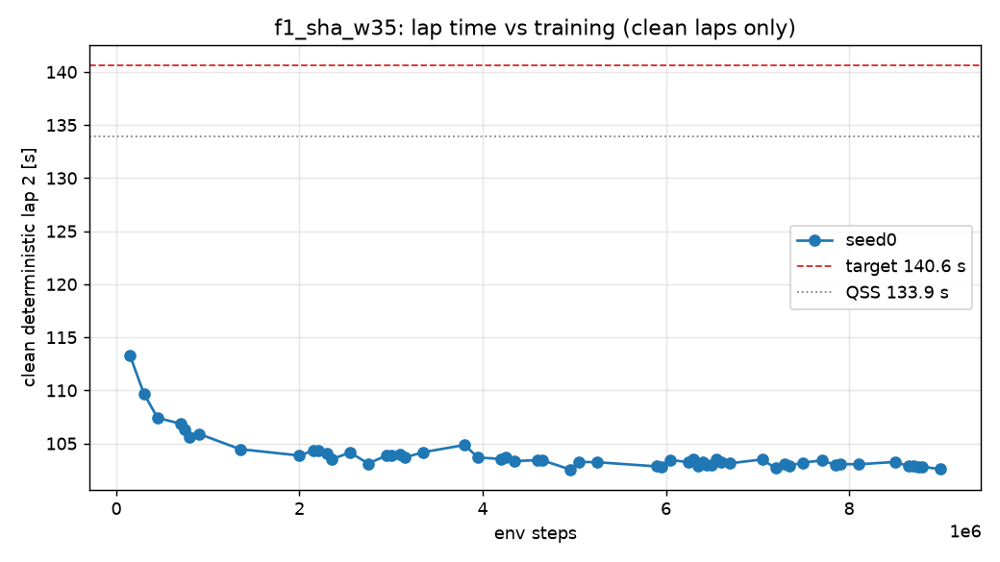

# D2 run `f1_sha_w35` — per-seed progress

Generated 2026-11-04 12:20 (local) by `scripts/seed_summary.py`. Done criterion (DECISIONS #12): clean deterministic flying lap 2 ≤ 140.6 s on all 3 seeds, plateau < 0.2 s over the last 20 %, seed std ≤ 0.2 s, ≥ 9/10 stochastic laps clean. Evaluations every 50k steps; "det." = deterministic policy, flying lap 2 after a run-in lap.

## seed0

- **State:** phase `rl`, state `running`, rollbacks 0, updated 2026-11-04T10:18:40+00:00 UTC
- **BC (instructive init):** epochs 22, best val NLL -2.627, gate lap 2 — s (FAIL: off_track)
- event `unfreeze` at step 20000 (2026-11-03T22:08:31)
- event `det_regression` at step 200000 (2026-11-03T22:23:29)
- event `det_regression` at step 350000 (2026-11-03T22:35:44)
- event `det_regression` at step 500000 (2026-11-03T22:47:45)
- event `det_regression` at step 850000 (2026-11-03T23:15:56)
- event `det_regression` at step 950000 (2026-11-03T23:24:03)
- event `det_regression` at step 1400000 (2026-11-04T00:00:35)
- event `det_regression` at step 2050000 (2026-11-04T00:52:53)
- event `det_regression` at step 2250000 (2026-11-04T01:09:14)
- event `det_regression` at step 2400000 (2026-11-04T01:21:53)
- event `det_regression` at step 2600000 (2026-11-04T01:38:13)
- event `det_regression` at step 2800000 (2026-11-04T01:54:49)
- event `det_regression` at step 3050000 (2026-11-04T02:15:08)
- event `det_regression` at step 3200000 (2026-11-04T02:27:34)
- event `det_regression` at step 3400000 (2026-11-04T02:44:15)
- event `det_regression` at step 3850000 (2026-11-04T03:18:17)
- event `det_regression` at step 4000000 (2026-11-04T03:29:19)
- event `det_regression` at step 4300000 (2026-11-04T03:51:24)
- event `det_regression` at step 4400000 (2026-11-04T03:59:18)
- event `det_regression` at step 4700000 (2026-11-04T04:22:17)
- event `det_regression` at step 5000000 (2026-11-04T05:35:29)
- event `det_regression` at step 5100000 (2026-11-04T05:43:19)
- event `det_regression` at step 5300000 (2026-11-04T05:57:26)
- event `det_regression` at step 6000000 (2026-11-04T06:45:57)
- event `det_regression` at step 6100000 (2026-11-04T06:52:52)
- event `det_regression` at step 6650000 (2026-11-04T07:31:28)
- event `det_regression` at step 6750000 (2026-11-04T07:38:20)
- event `det_regression` at step 7100000 (2026-11-04T08:03:08)
- event `det_regression` at step 7250000 (2026-11-04T08:13:38)
- event `det_regression` at step 7400000 (2026-11-04T08:24:13)
- event `det_regression` at step 7550000 (2026-11-04T08:34:43)
- event `det_regression` at step 7750000 (2026-11-04T08:48:49)
- event `det_regression` at step 7950000 (2026-11-04T09:02:57)
- event `det_regression` at step 8150000 (2026-11-04T09:17:18)
- event `det_regression` at step 8550000 (2026-11-04T09:46:01)
- event `det_regression` at step 8850000 (2026-11-04T10:07:31)
- **Best clean deterministic lap 2:** 102.57 s at step 4,950,000 (target ≤ 140.6 s, QSS 133.9 s)
- **Latest eval:** step 9,000,000; deterministic clean 102.57 s; stochastic clean 3/10; train wall 10.43 h; 235 env steps/s

| step | det. result | lap 1 [s] | lap 2 [s] | stoch. clean | stoch. mean lap [s] | α | Q_min / MC | failure causes (training, cumulative) |
|---:|---|---:|---:|---:|---:|---:|---:|---|
| 0 | off_track | — | — | 4/10 | 151.35 | 0.100 | 1.06 |  |
| 50,000 | off_track | — | — | 0/10 | — | 0.082 | 1.39 | off_track 97, time_limit 9, wrong_way 2, stall 3 |
| 100,000 | off_track | — | — | 0/10 | — | 0.072 | 1.13 | off_track 155, time_limit 20, wrong_way 4, stall 7 |
| 150,000 | clean | 113.57 | 113.27 | 1/10 | 116.81 | 0.080 | 1.12 | off_track 189, time_limit 35, wrong_way 4, stall 8 |
| 200,000 | off_track | — | — | 0/10 | — | 0.086 | 1.10 | off_track 235, time_limit 48, wrong_way 5, stall 8 |
| 250,000 | off_track | — | — | 0/10 | — | 0.086 | 1.14 | off_track 268, time_limit 66, wrong_way 5, stall 8 |
| 300,000 | clean | 110.48 | 109.72 | 9/10 | 112.84 | 0.088 | 1.03 | off_track 291, time_limit 88, wrong_way 5, stall 8 |
| 350,000 | off_track | 110.41 | — | 9/10 | 112.42 | 0.079 | 1.01 | off_track 313, time_limit 110, wrong_way 5, stall 8 |
| 400,000 | off_track | — | — | 3/10 | 111.81 | 0.084 | 1.05 | off_track 328, time_limit 136, wrong_way 5, stall 8 |
| 450,000 | clean | 108.03 | 107.42 | 7/10 | 110.38 | 0.080 | 1.01 | off_track 346, time_limit 161, wrong_way 6, stall 9 |
| 500,000 | off_track | — | — | 0/10 | — | 0.083 | 1.24 | off_track 368, time_limit 185, wrong_way 6, stall 9 |
| 550,000 | off_track | — | — | 2/10 | 109.45 | 0.083 | 1.12 | off_track 391, time_limit 207, wrong_way 6, stall 9 |
| 600,000 | off_track | — | — | 5/10 | 108.47 | 0.083 | 1.02 | off_track 407, time_limit 233, wrong_way 6, stall 9 |
| 650,000 | off_track | — | — | 4/10 | 109.48 | 0.079 | 1.02 | off_track 421, time_limit 258, wrong_way 6, stall 9 |
| 700,000 | clean | 107.11 | 106.86 | 7/10 | 109.69 | 0.079 | 1.02 | off_track 436, time_limit 286, wrong_way 6, stall 9 |
| 750,000 | clean | 106.13 | 106.31 | 6/10 | 108.62 | 0.083 | 1.03 | off_track 439, time_limit 317, wrong_way 6, stall 9 |
| 800,000 | clean | 105.90 | 105.60 | 8/10 | 108.52 | 0.074 | 1.00 | off_track 448, time_limit 344, wrong_way 7, stall 9 |
| 850,000 | off_track | 106.39 | — | 10/10 | 107.79 | 0.076 | 0.99 | off_track 461, time_limit 370, wrong_way 7, stall 9 |
| 900,000 | clean | 106.67 | 105.91 | 9/10 | 108.41 | 0.067 | 1.00 | off_track 468, time_limit 399, wrong_way 7, stall 9 |
| 950,000 | off_track | — | — | 4/10 | 107.85 | 0.067 | 1.04 | off_track 478, time_limit 427, wrong_way 7, stall 9 |
| 1,000,000 | off_track | — | — | 4/10 | 107.11 | 0.071 | 1.03 | off_track 487, time_limit 456, wrong_way 7, stall 9 |
| 1,050,000 | off_track | — | — | 3/10 | 107.01 | 0.060 | 1.04 | off_track 493, time_limit 487, wrong_way 7, stall 9 |
| 1,100,000 | off_track | — | — | 8/10 | 106.62 | 0.063 | 1.01 | off_track 504, time_limit 514, wrong_way 7, stall 10 |
| 1,150,000 | off_track | — | — | 8/10 | 106.45 | 0.058 | 1.01 | off_track 514, time_limit 542, wrong_way 7, stall 10 |
| 1,200,000 | off_track | — | — | 6/10 | 106.90 | 0.055 | 1.02 | off_track 526, time_limit 568, wrong_way 7, stall 10 |
| 1,250,000 | off_track | — | — | 0/10 | — | 0.056 | 1.08 | off_track 532, time_limit 599, wrong_way 8, stall 10 |
| 1,300,000 | off_track | — | — | 1/10 | 106.05 | 0.054 | 1.08 | off_track 539, time_limit 628, wrong_way 8, stall 10 |
| 1,350,000 | clean | 104.44 | 104.47 | 3/10 | 106.71 | 0.050 | 1.07 | off_track 548, time_limit 657, wrong_way 9, stall 10 |
| 1,400,000 | off_track | — | — | 3/10 | 105.72 | 0.054 | 1.08 | off_track 566, time_limit 681, wrong_way 9, stall 10 |
| 1,450,000 | wrong_way | — | — | 5/10 | 106.99 | 0.053 | 1.07 | off_track 584, time_limit 706, wrong_way 9, stall 10 |
| 1,500,000 | off_track | 104.96 | — | 6/10 | 106.35 | 0.052 | 1.04 | off_track 612, time_limit 726, wrong_way 10, stall 10 |
| 1,550,000 | off_track | — | — | 8/10 | 106.89 | 0.052 | 1.03 | off_track 617, time_limit 756, wrong_way 10, stall 10 |
| 1,600,000 | off_track | — | — | 3/10 | 107.14 | 0.054 | 1.08 | off_track 627, time_limit 785, wrong_way 10, stall 10 |
| 1,650,000 | off_track | — | — | 8/10 | 107.20 | 0.051 | 1.02 | off_track 642, time_limit 810, wrong_way 10, stall 10 |
| 1,700,000 | off_track | — | — | 10/10 | 106.25 | 0.054 | 1.01 | off_track 650, time_limit 840, wrong_way 10, stall 10 |
| 1,750,000 | off_track | — | — | 4/10 | 107.66 | 0.052 | 1.06 | off_track 670, time_limit 862, wrong_way 10, stall 10 |
| 1,800,000 | off_track | 105.16 | — | 6/10 | 106.66 | 0.052 | 1.04 | off_track 680, time_limit 890, wrong_way 10, stall 10 |
| 1,850,000 | off_track | — | — | 0/10 | — | 0.053 | 1.15 | off_track 688, time_limit 919, wrong_way 10, stall 10 |
| 1,900,000 | off_track | — | — | 3/10 | 106.67 | 0.050 | 1.07 | off_track 708, time_limit 943, wrong_way 10, stall 10 |
| 1,950,000 | off_track | — | — | 4/10 | 105.96 | 0.050 | 1.04 | off_track 719, time_limit 970, wrong_way 10, stall 10 |
| 2,000,000 | clean | 104.97 | 103.87 | 3/10 | 106.47 | 0.051 | 1.08 | off_track 724, time_limit 1002, wrong_way 11, stall 10 |
| 2,050,000 | off_track | — | — | 6/10 | 106.63 | 0.053 | 1.04 | off_track 734, time_limit 1031, wrong_way 11, stall 10 |
| 2,100,000 | off_track | 104.82 | — | 1/10 | 106.63 | 0.051 | 1.16 | off_track 742, time_limit 1059, wrong_way 11, stall 10 |
| 2,150,000 | clean | 104.52 | 104.34 | 9/10 | 106.20 | 0.052 | 1.01 | off_track 752, time_limit 1087, wrong_way 11, stall 10 |
| 2,200,000 | clean | 104.62 | 104.30 | 9/10 | 106.15 | 0.056 | 1.02 | off_track 762, time_limit 1120, wrong_way 11, stall 10 |
| 2,250,000 | off_track | — | — | 2/10 | 106.69 | 0.048 | 1.09 | off_track 776, time_limit 1144, wrong_way 11, stall 10 |
| 2,300,000 | clean | 104.40 | 104.02 | 9/10 | 106.31 | 0.053 | 1.01 | off_track 794, time_limit 1168, wrong_way 11, stall 10 |
| 2,350,000 | clean | 104.02 | 103.50 | 5/10 | 105.49 | 0.056 | 1.04 | off_track 801, time_limit 1200, wrong_way 11, stall 10 |
| 2,400,000 | off_track | — | — | 4/10 | 105.47 | 0.055 | 1.07 | off_track 812, time_limit 1227, wrong_way 11, stall 10 |
| 2,450,000 | off_track | — | — | 6/10 | 106.27 | 0.049 | 1.03 | off_track 820, time_limit 1257, wrong_way 12, stall 10 |
| 2,500,000 | off_track | — | — | 3/10 | 106.01 | 0.050 | 1.11 | off_track 828, time_limit 1286, wrong_way 12, stall 10 |
| 2,550,000 | clean | 104.27 | 104.16 | 10/10 | 106.05 | 0.052 | 1.00 | off_track 840, time_limit 1314, wrong_way 12, stall 10 |
| 2,600,000 | off_track | — | — | 9/10 | 106.62 | 0.052 | 1.02 | off_track 849, time_limit 1343, wrong_way 13, stall 10 |
| 2,650,000 | off_track | — | — | 4/10 | 106.15 | 0.048 | 1.04 | off_track 861, time_limit 1372, wrong_way 13, stall 10 |
| 2,700,000 | off_track | — | — | 9/10 | 106.07 | 0.050 | 1.01 | off_track 872, time_limit 1402, wrong_way 13, stall 10 |
| 2,750,000 | clean | 103.55 | 103.11 | 4/10 | 105.56 | 0.053 | 1.05 | off_track 885, time_limit 1428, wrong_way 14, stall 10 |
| 2,800,000 | off_track | — | — | 4/10 | 105.92 | 0.049 | 1.05 | off_track 898, time_limit 1456, wrong_way 14, stall 10 |
| 2,850,000 | off_track | — | — | 6/10 | 105.43 | 0.053 | 1.04 | off_track 911, time_limit 1483, wrong_way 14, stall 10 |
| 2,900,000 | off_track | — | — | 1/10 | 106.19 | 0.049 | 1.18 | off_track 923, time_limit 1511, wrong_way 15, stall 10 |
| 2,950,000 | clean | 104.02 | 103.87 | 6/10 | 105.89 | 0.050 | 1.03 | off_track 934, time_limit 1538, wrong_way 16, stall 10 |
| 3,000,000 | clean | 103.84 | 103.86 | 3/10 | 106.02 | 0.051 | 1.06 | off_track 944, time_limit 1565, wrong_way 16, stall 10 |
| 3,050,000 | off_track | — | — | 3/10 | 105.85 | 0.050 | 1.08 | off_track 952, time_limit 1596, wrong_way 16, stall 10 |
| 3,100,000 | clean | 103.91 | 103.96 | 10/10 | 106.29 | 0.056 | 1.02 | off_track 970, time_limit 1620, wrong_way 16, stall 10 |
| 3,150,000 | clean | 103.84 | 103.69 | 8/10 | 105.85 | 0.053 | 1.02 | off_track 980, time_limit 1648, wrong_way 16, stall 10 |
| 3,200,000 | off_track | — | — | 5/10 | 105.73 | 0.053 | 1.04 | off_track 987, time_limit 1678, wrong_way 16, stall 10 |
| 3,250,000 | off_track | — | — | 7/10 | 105.46 | 0.054 | 1.04 | off_track 995, time_limit 1707, wrong_way 17, stall 10 |
| 3,300,000 | off_track | — | — | 8/10 | 105.74 | 0.055 | 1.03 | off_track 1006, time_limit 1736, wrong_way 17, stall 10 |
| 3,350,000 | clean | 104.45 | 104.18 | 9/10 | 105.81 | 0.055 | 1.03 | off_track 1018, time_limit 1765, wrong_way 17, stall 10 |
| 3,400,000 | off_track | 104.20 | — | 7/10 | 105.75 | 0.049 | 1.02 | off_track 1023, time_limit 1796, wrong_way 17, stall 10 |
| 3,450,000 | off_track | 103.84 | — | 1/10 | 105.62 | 0.055 | 1.16 | off_track 1031, time_limit 1824, wrong_way 17, stall 10 |
| 3,500,000 | off_track | — | — | 9/10 | 105.97 | 0.053 | 1.02 | off_track 1041, time_limit 1854, wrong_way 17, stall 10 |
| 3,550,000 | off_track | — | — | 3/10 | 105.52 | 0.052 | 1.06 | off_track 1050, time_limit 1883, wrong_way 17, stall 10 |
| 3,600,000 | off_track | 103.57 | — | 10/10 | 105.32 | 0.055 | 1.01 | off_track 1057, time_limit 1914, wrong_way 17, stall 10 |
| 3,650,000 | off_track | — | — | 10/10 | 105.60 | 0.051 | 1.01 | off_track 1064, time_limit 1944, wrong_way 17, stall 10 |
| 3,700,000 | off_track | — | — | 6/10 | 106.59 | 0.055 | 1.05 | off_track 1073, time_limit 1974, wrong_way 17, stall 10 |
| 3,750,000 | off_track | — | — | 7/10 | 105.67 | 0.051 | 1.02 | off_track 1081, time_limit 2002, wrong_way 18, stall 10 |
| 3,800,000 | clean | 104.97 | 104.86 | 2/10 | 107.40 | 0.050 | 1.08 | off_track 1091, time_limit 2031, wrong_way 18, stall 10 |
| 3,850,000 | off_track | 103.86 | — | 7/10 | 105.22 | 0.053 | 1.03 | off_track 1101, time_limit 2060, wrong_way 18, stall 10 |
| 3,900,000 | off_track | — | — | 8/10 | 105.46 | 0.055 | 1.03 | off_track 1115, time_limit 2086, wrong_way 18, stall 10 |
| 3,950,000 | clean | 103.92 | 103.68 | 7/10 | 105.88 | 0.053 | 1.03 | off_track 1127, time_limit 2115, wrong_way 20, stall 10 |
| 4,000,000 | off_track | — | — | 8/10 | 105.49 | 0.052 | 1.02 | off_track 1147, time_limit 2138, wrong_way 20, stall 10 |
| 4,050,000 | off_track | — | — | 4/10 | 105.42 | 0.053 | 1.07 | off_track 1156, time_limit 2167, wrong_way 20, stall 10 |
| 4,100,000 | off_track | — | — | 6/10 | 105.45 | 0.051 | 1.04 | off_track 1164, time_limit 2195, wrong_way 20, stall 10 |
| 4,150,000 | off_track | — | — | 7/10 | 105.29 | 0.053 | 1.04 | off_track 1171, time_limit 2226, wrong_way 20, stall 10 |
| 4,200,000 | clean | 103.52 | 103.55 | 7/10 | 104.78 | 0.055 | 1.03 | off_track 1187, time_limit 2252, wrong_way 20, stall 10 |
| 4,250,000 | clean | 104.06 | 103.71 | 8/10 | 105.63 | 0.053 | 1.03 | off_track 1203, time_limit 2278, wrong_way 20, stall 10 |
| 4,300,000 | off_track | 103.93 | — | 8/10 | 105.59 | 0.054 | 1.02 | off_track 1206, time_limit 2310, wrong_way 20, stall 10 |
| 4,350,000 | clean | 103.33 | 103.34 | 6/10 | 105.21 | 0.054 | 1.04 | off_track 1213, time_limit 2339, wrong_way 20, stall 10 |
| 4,400,000 | off_track | — | — | 8/10 | 105.23 | 0.056 | 1.03 | off_track 1224, time_limit 2367, wrong_way 20, stall 10 |
| 4,450,000 | off_track | — | — | 9/10 | 104.87 | 0.054 | 1.02 | off_track 1230, time_limit 2398, wrong_way 20, stall 10 |
| 4,500,000 | off_track | 103.69 | — | 3/10 | 105.21 | 0.055 | 1.09 | off_track 1240, time_limit 2427, wrong_way 21, stall 10 |
| 4,550,000 | off_track | — | — | 10/10 | 105.52 | 0.051 | 1.01 | off_track 1249, time_limit 2456, wrong_way 21, stall 10 |
| 4,600,000 | clean | 103.82 | 103.43 | 9/10 | 105.29 | 0.052 | 1.02 | off_track 1260, time_limit 2485, wrong_way 21, stall 10 |
| 4,650,000 | clean | 104.03 | 103.41 | 7/10 | 105.20 | 0.057 | 1.03 | off_track 1273, time_limit 2513, wrong_way 22, stall 10 |
| 4,700,000 | off_track | — | — | 7/10 | 105.60 | 0.051 | 1.03 | off_track 1280, time_limit 2543, wrong_way 22, stall 12 |
| 4,750,000 | off_track | — | — | 3/10 | 105.41 | 0.054 | 1.05 | off_track 1290, time_limit 2571, wrong_way 22, stall 12 |
| 4,800,000 | off_track | — | — | 4/10 | 105.65 | 0.057 | 1.07 | off_track 1300, time_limit 2601, wrong_way 22, stall 12 |
| 4,850,000 | off_track | — | — | 3/10 | 105.32 | 0.056 | 1.05 | off_track 1304, time_limit 2632, wrong_way 22, stall 12 |
| 4,900,000 | off_track | 103.77 | — | 6/10 | 105.26 | 0.052 | 1.04 | off_track 1310, time_limit 2662, wrong_way 22, stall 12 |
| 4,950,000 | clean | 103.08 | 102.57 | 4/10 | 104.31 | 0.053 | 1.05 | off_track 1316, time_limit 2692, wrong_way 22, stall 12 |
| 5,000,000 | off_track | — | — | 6/10 | 104.92 | 0.054 | 1.05 | off_track 1327, time_limit 2718, wrong_way 22, stall 12 |
| 5,050,000 | clean | 103.40 | 103.27 | 9/10 | 104.92 | 0.052 | 1.01 | off_track 1336, time_limit 2748, wrong_way 22, stall 12 |
| 5,100,000 | off_track | — | — | 5/10 | 104.70 | 0.055 | 1.05 | off_track 1344, time_limit 2777, wrong_way 23, stall 12 |
| 5,150,000 | off_track | — | — | 6/10 | 105.00 | 0.052 | 1.04 | off_track 1354, time_limit 2807, wrong_way 23, stall 12 |
| 5,200,000 | off_track | — | — | 8/10 | 104.85 | 0.054 | 1.02 | off_track 1366, time_limit 2833, wrong_way 23, stall 12 |
| 5,250,000 | clean | 103.43 | 103.23 | 7/10 | 105.02 | 0.053 | 1.03 | off_track 1371, time_limit 2866, wrong_way 23, stall 12 |
| 5,300,000 | off_track | — | — | 8/10 | 105.62 | 0.051 | 1.02 | off_track 1378, time_limit 2898, wrong_way 23, stall 12 |
| 5,350,000 | off_track | — | — | 5/10 | 104.83 | 0.053 | 1.05 | off_track 1384, time_limit 2928, wrong_way 23, stall 12 |
| 5,400,000 | off_track | — | — | 8/10 | 104.72 | 0.057 | 1.03 | off_track 1397, time_limit 2955, wrong_way 23, stall 12 |
| 5,450,000 | off_track | — | — | 5/10 | 104.88 | 0.050 | 1.05 | off_track 1407, time_limit 2984, wrong_way 23, stall 12 |
| 5,500,000 | off_track | — | — | 2/10 | 105.94 | 0.050 | 1.10 | off_track 1413, time_limit 3013, wrong_way 23, stall 12 |
| 5,550,000 | off_track | — | — | 6/10 | 105.05 | 0.053 | 1.05 | off_track 1423, time_limit 3041, wrong_way 23, stall 12 |
| 5,600,000 | off_track | — | — | 5/10 | 105.10 | 0.053 | 1.05 | off_track 1435, time_limit 3069, wrong_way 23, stall 12 |
| 5,650,000 | off_track | — | — | 7/10 | 105.07 | 0.054 | 1.04 | off_track 1444, time_limit 3098, wrong_way 23, stall 12 |
| 5,700,000 | off_track | — | — | 3/10 | 105.39 | 0.053 | 1.09 | off_track 1460, time_limit 3122, wrong_way 23, stall 12 |
| 5,750,000 | off_track | — | — | 8/10 | 104.98 | 0.055 | 1.03 | off_track 1475, time_limit 3149, wrong_way 23, stall 12 |
| 5,800,000 | off_track | — | — | 9/10 | 105.40 | 0.050 | 1.02 | off_track 1486, time_limit 3178, wrong_way 24, stall 12 |
| 5,850,000 | off_track | — | — | 6/10 | 105.62 | 0.052 | 1.05 | off_track 1501, time_limit 3205, wrong_way 24, stall 12 |
| 5,900,000 | clean | 103.31 | 102.84 | 9/10 | 105.54 | 0.053 | 1.02 | off_track 1503, time_limit 3237, wrong_way 24, stall 12 |
| 5,950,000 | clean | 103.11 | 102.77 | 3/10 | 105.18 | 0.054 | 1.05 | off_track 1522, time_limit 3263, wrong_way 24, stall 12 |
| 6,000,000 | off_track | — | — | 3/10 | 105.58 | 0.054 | 1.05 | off_track 1525, time_limit 3295, wrong_way 24, stall 12 |
| 6,050,000 | clean | 103.36 | 103.45 | 7/10 | 105.05 | 0.054 | 1.03 | off_track 1535, time_limit 3322, wrong_way 24, stall 12 |
| 6,100,000 | off_track | — | — | 5/10 | 104.97 | 0.049 | 1.05 | off_track 1541, time_limit 3353, wrong_way 24, stall 12 |
| 6,150,000 | off_track | — | — | 3/10 | 105.57 | 0.056 | 1.06 | off_track 1546, time_limit 3384, wrong_way 24, stall 12 |
| 6,200,000 | off_track | 103.27 | — | 1/10 | 104.69 | 0.052 | 1.07 | off_track 1558, time_limit 3411, wrong_way 24, stall 12 |
| 6,250,000 | clean | 103.31 | 103.23 | 7/10 | 105.01 | 0.050 | 1.03 | off_track 1562, time_limit 3443, wrong_way 24, stall 12 |
| 6,300,000 | clean | 103.63 | 103.50 | 8/10 | 105.34 | 0.050 | 1.02 | off_track 1579, time_limit 3468, wrong_way 24, stall 12 |
| 6,350,000 | clean | 103.30 | 102.91 | 9/10 | 104.85 | 0.051 | 1.02 | off_track 1586, time_limit 3498, wrong_way 24, stall 12 |
| 6,400,000 | clean | 103.31 | 103.29 | 6/10 | 105.02 | 0.050 | 1.06 | off_track 1592, time_limit 3529, wrong_way 24, stall 12 |
| 6,450,000 | clean | 103.31 | 102.98 | 9/10 | 105.17 | 0.050 | 1.02 | off_track 1599, time_limit 3560, wrong_way 24, stall 12 |
| 6,500,000 | clean | 102.97 | 102.98 | 10/10 | 104.78 | 0.052 | 1.01 | off_track 1609, time_limit 3588, wrong_way 24, stall 12 |
| 6,550,000 | clean | 103.71 | 103.54 | 10/10 | 105.43 | 0.049 | 1.01 | off_track 1618, time_limit 3617, wrong_way 24, stall 12 |
| 6,600,000 | clean | 103.57 | 103.21 | 9/10 | 105.12 | 0.051 | 1.02 | off_track 1619, time_limit 3651, wrong_way 24, stall 12 |
| 6,650,000 | off_track | — | — | 9/10 | 104.95 | 0.049 | 1.02 | off_track 1623, time_limit 3681, wrong_way 24, stall 12 |
| 6,700,000 | clean | 103.32 | 103.13 | 9/10 | 104.90 | 0.048 | 1.02 | off_track 1626, time_limit 3714, wrong_way 24, stall 12 |
| 6,750,000 | off_track | — | — | 0/10 | — | 0.050 | 1.20 | off_track 1633, time_limit 3745, wrong_way 24, stall 12 |
| 6,800,000 | off_track | — | — | 8/10 | 104.90 | 0.050 | 1.02 | off_track 1644, time_limit 3772, wrong_way 24, stall 12 |
| 6,850,000 | off_track | — | — | 9/10 | 105.10 | 0.047 | 1.01 | off_track 1660, time_limit 3799, wrong_way 24, stall 12 |
| 6,900,000 | off_track | — | — | 10/10 | 105.10 | 0.045 | 1.01 | off_track 1666, time_limit 3831, wrong_way 24, stall 12 |
| 6,950,000 | off_track | — | — | 9/10 | 105.32 | 0.045 | 1.02 | off_track 1677, time_limit 3861, wrong_way 24, stall 12 |
| 7,000,000 | off_track | — | — | 3/10 | 105.41 | 0.049 | 1.08 | off_track 1686, time_limit 3890, wrong_way 24, stall 12 |
| 7,050,000 | clean | 103.56 | 103.50 | 6/10 | 105.26 | 0.054 | 1.05 | off_track 1704, time_limit 3915, wrong_way 24, stall 12 |
| 7,100,000 | off_track | — | — | 8/10 | 105.10 | 0.052 | 1.03 | off_track 1713, time_limit 3945, wrong_way 24, stall 13 |
| 7,150,000 | off_track | — | — | 4/10 | 104.89 | 0.052 | 1.07 | off_track 1728, time_limit 3971, wrong_way 24, stall 13 |
| 7,200,000 | clean | 102.65 | 102.66 | 6/10 | 104.62 | 0.053 | 1.05 | off_track 1736, time_limit 4000, wrong_way 24, stall 13 |
| 7,250,000 | off_track | 103.52 | — | 5/10 | 105.06 | 0.052 | 1.05 | off_track 1744, time_limit 4029, wrong_way 24, stall 13 |
| 7,300,000 | clean | 103.18 | 103.05 | 8/10 | 104.56 | 0.051 | 1.03 | off_track 1750, time_limit 4059, wrong_way 24, stall 13 |
| 7,350,000 | clean | 103.28 | 102.93 | 6/10 | 104.88 | 0.048 | 1.04 | off_track 1763, time_limit 4085, wrong_way 24, stall 14 |
| 7,400,000 | off_track | — | — | 2/10 | 104.45 | 0.049 | 1.07 | off_track 1775, time_limit 4113, wrong_way 25, stall 14 |
| 7,450,000 | off_track | 103.10 | — | 2/10 | 105.58 | 0.049 | 1.10 | off_track 1787, time_limit 4138, wrong_way 25, stall 14 |
| 7,500,000 | clean | 103.51 | 103.20 | 8/10 | 105.29 | 0.052 | 1.03 | off_track 1791, time_limit 4170, wrong_way 25, stall 14 |
| 7,550,000 | off_track | — | — | 1/10 | 105.07 | 0.053 | 1.12 | off_track 1798, time_limit 4199, wrong_way 25, stall 14 |
| 7,600,000 | off_track | — | — | 2/10 | 104.66 | 0.052 | 1.08 | off_track 1803, time_limit 4230, wrong_way 25, stall 14 |
| 7,650,000 | off_track | — | — | 7/10 | 105.18 | 0.052 | 1.04 | off_track 1820, time_limit 4255, wrong_way 25, stall 14 |
| 7,700,000 | clean | 103.98 | 103.41 | 10/10 | 105.32 | 0.053 | 1.02 | off_track 1827, time_limit 4285, wrong_way 25, stall 14 |
| 7,750,000 | off_track | — | — | 7/10 | 105.01 | 0.055 | 1.03 | off_track 1838, time_limit 4312, wrong_way 25, stall 14 |
| 7,800,000 | off_track | — | — | 3/10 | 104.57 | 0.053 | 1.07 | off_track 1842, time_limit 4344, wrong_way 25, stall 14 |
| 7,850,000 | clean | 103.34 | 102.98 | 5/10 | 104.89 | 0.054 | 1.05 | off_track 1855, time_limit 4371, wrong_way 25, stall 14 |
| 7,900,000 | clean | 103.15 | 103.06 | 7/10 | 105.04 | 0.051 | 1.03 | off_track 1858, time_limit 4403, wrong_way 25, stall 14 |
| 7,950,000 | off_track | — | — | 5/10 | 105.60 | 0.050 | 1.05 | off_track 1864, time_limit 4433, wrong_way 25, stall 14 |
| 8,000,000 | off_track | — | — | 3/10 | 104.85 | 0.053 | 1.15 | off_track 1874, time_limit 4463, wrong_way 25, stall 14 |
| 8,050,000 | off_track | — | — | 6/10 | 104.92 | 0.050 | 1.04 | off_track 1881, time_limit 4491, wrong_way 25, stall 14 |
| 8,100,000 | clean | 103.16 | 103.04 | 10/10 | 104.62 | 0.055 | 1.01 | off_track 1901, time_limit 4514, wrong_way 26, stall 14 |
| 8,150,000 | off_track | 103.89 | — | 9/10 | 105.36 | 0.051 | 1.01 | off_track 1909, time_limit 4546, wrong_way 26, stall 14 |
| 8,200,000 | off_track | — | — | 5/10 | 105.13 | 0.058 | 1.05 | off_track 1914, time_limit 4578, wrong_way 26, stall 14 |
| 8,250,000 | off_track | — | — | 2/10 | 105.71 | 0.076 | 1.13 | off_track 1928, time_limit 4607, wrong_way 26, stall 14 |
| 8,300,000 | off_track | — | — | 9/10 | 104.97 | 0.061 | 1.01 | off_track 1939, time_limit 4635, wrong_way 26, stall 14 |
| 8,350,000 | off_track | — | — | 9/10 | 105.04 | 0.054 | 1.01 | off_track 1949, time_limit 4663, wrong_way 26, stall 14 |
| 8,400,000 | off_track | 103.16 | — | 9/10 | 104.84 | 0.056 | 1.02 | off_track 1957, time_limit 4694, wrong_way 26, stall 14 |
| 8,450,000 | off_track | — | — | 9/10 | 104.87 | 0.052 | 1.02 | off_track 1959, time_limit 4726, wrong_way 26, stall 14 |
| 8,500,000 | clean | 103.52 | 103.26 | 10/10 | 104.91 | 0.054 | 1.01 | off_track 1967, time_limit 4756, wrong_way 26, stall 14 |
| 8,550,000 | off_track | — | — | 4/10 | 104.56 | 0.050 | 1.06 | off_track 1975, time_limit 4785, wrong_way 26, stall 14 |
| 8,600,000 | off_track | — | — | 0/10 | — | 0.050 | 1.28 | off_track 1990, time_limit 4811, wrong_way 26, stall 14 |
| 8,650,000 | clean | 102.95 | 102.86 | 10/10 | 104.84 | 0.053 | 1.01 | off_track 1996, time_limit 4840, wrong_way 26, stall 14 |
| 8,700,000 | clean | 103.08 | 102.87 | 9/10 | 104.93 | 0.049 | 1.01 | off_track 2004, time_limit 4870, wrong_way 26, stall 14 |
| 8,750,000 | clean | 103.33 | 102.80 | 6/10 | 105.19 | 0.051 | 1.04 | off_track 2012, time_limit 4902, wrong_way 26, stall 14 |
| 8,800,000 | clean | 103.02 | 102.81 | 6/10 | 104.60 | 0.051 | 1.04 | off_track 2025, time_limit 4929, wrong_way 26, stall 14 |
| 8,850,000 | off_track | 102.92 | — | 7/10 | 104.68 | 0.049 | 1.03 | off_track 2042, time_limit 4954, wrong_way 26, stall 14 |
| 8,900,000 | off_track | 103.52 | — | 7/10 | 104.79 | 0.050 | 1.03 | off_track 2050, time_limit 4983, wrong_way 26, stall 14 |
| 8,950,000 | off_track | — | — | 9/10 | 104.79 | 0.051 | 1.02 | off_track 2060, time_limit 5010, wrong_way 26, stall 14 |
| 9,000,000 | clean | 102.95 | 102.57 | 3/10 | 104.90 | 0.052 | 1.09 | off_track 2065, time_limit 5043, wrong_way 26, stall 14 |

