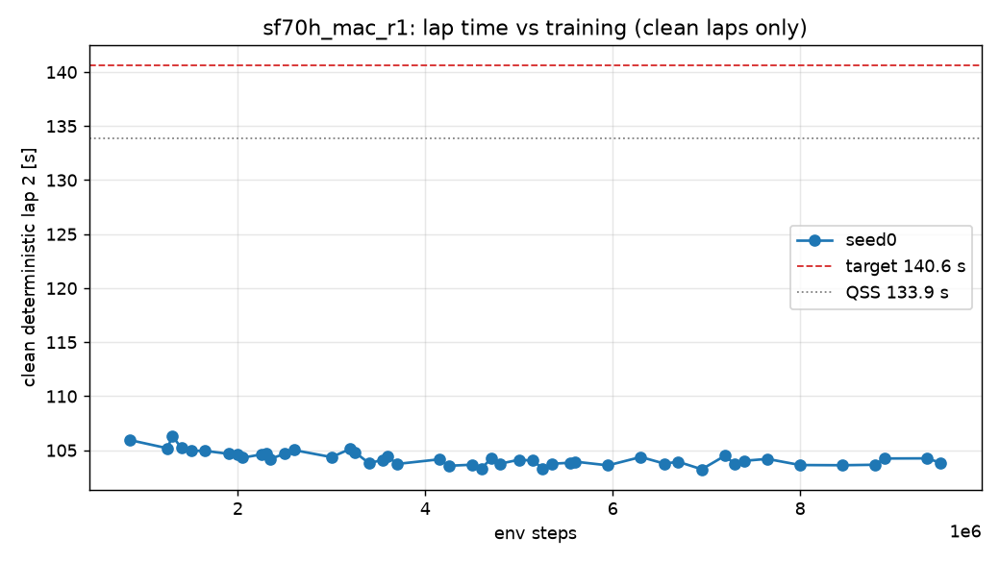

# D2 run `sf70h_mac_r1` — per-seed progress

Generated 2026-10-28 09:19 (local) by `scripts/seed_summary.py`. Done criterion (DECISIONS #12): clean deterministic flying lap 2 ≤ 140.6 s on all 3 seeds, plateau < 0.2 s over the last 20 %, seed std ≤ 0.2 s, ≥ 9/10 stochastic laps clean. Evaluations every 50k steps; "det." = deterministic policy, flying lap 2 after a run-in lap.

## seed0

- **State:** phase `rl`, state `running`, rollbacks 0, updated 2026-10-28T07:16:44+00:00 UTC
- **BC (instructive init):** epochs 15, best val NLL -3.256, gate lap 2 — s (FAIL: off_track)
- event `unfreeze` at step 20000 (2026-10-27T18:37:59)
- event `det_regression` at step 900000 (2026-10-27T19:44:13)
- event `det_regression` at step 1350000 (2026-10-27T20:19:11)
- event `det_regression` at step 1450000 (2026-10-27T20:27:56)
- event `det_regression` at step 1550000 (2026-10-27T20:36:35)
- event `det_regression` at step 1700000 (2026-10-27T20:51:09)
- event `det_regression` at step 1950000 (2026-10-27T21:16:16)
- event `det_regression` at step 2100000 (2026-10-27T21:29:13)
- event `det_regression` at step 2400000 (2026-10-27T21:52:44)
- event `det_regression` at step 2550000 (2026-10-27T22:04:19)
- event `det_regression` at step 2650000 (2026-10-27T22:11:55)
- event `det_regression` at step 3050000 (2026-10-27T22:42:12)
- event `det_regression` at step 3300000 (2026-10-27T23:01:37)
- event `det_regression` at step 3450000 (2026-10-27T23:12:44)
- event `det_regression` at step 3650000 (2026-10-27T23:27:53)
- event `det_regression` at step 3750000 (2026-10-27T23:35:21)
- event `det_regression` at step 4200000 (2026-10-28T00:09:10)
- event `det_regression` at step 4300000 (2026-10-28T00:16:42)
- event `det_regression` at step 4550000 (2026-10-28T00:35:44)
- event `det_regression` at step 4650000 (2026-10-28T00:43:15)
- event `det_regression` at step 4750000 (2026-10-28T00:50:42)
- event `det_regression` at step 4850000 (2026-10-28T00:58:21)
- event `det_regression` at step 5050000 (2026-10-28T01:13:35)
- event `det_regression` at step 5200000 (2026-10-28T01:25:08)
- event `det_regression` at step 5300000 (2026-10-28T01:32:56)
- event `det_regression` at step 5400000 (2026-10-28T01:40:38)
- event `det_regression` at step 5650000 (2026-10-28T02:00:03)
- event `det_regression` at step 6000000 (2026-10-28T02:27:00)
- event `det_regression` at step 6350000 (2026-10-28T02:53:47)
- event `det_regression` at step 6600000 (2026-10-28T03:12:34)
- event `det_regression` at step 6750000 (2026-10-28T03:23:57)
- event `det_regression` at step 7000000 (2026-10-28T03:43:13)
- event `det_regression` at step 7250000 (2026-10-28T04:02:40)
- event `det_regression` at step 7350000 (2026-10-28T04:10:10)
- event `det_regression` at step 7450000 (2026-10-28T04:18:02)
- event `det_regression` at step 7700000 (2026-10-28T04:38:17)
- event `det_regression` at step 8050000 (2026-10-28T05:05:27)
- event `det_regression` at step 8500000 (2026-10-28T05:39:12)
- event `det_regression` at step 8850000 (2026-10-28T06:06:01)
- event `det_regression` at step 8950000 (2026-10-28T06:13:46)
- event `det_regression` at step 9400000 (2026-10-28T06:47:52)
- event `det_regression` at step 9550000 (2026-10-28T06:59:39)
- **Best clean deterministic lap 2:** 103.24 s at step 6,950,000 (target ≤ 140.6 s, QSS 133.9 s)
- **Latest eval:** step 9,750,000; deterministic off_track; stochastic clean 9/10; train wall 11.59 h; 231 env steps/s

| step | det. result | lap 1 [s] | lap 2 [s] | stoch. clean | stoch. mean lap [s] | α | Q_min / MC | failure causes (training, cumulative) |
|---:|---|---:|---:|---:|---:|---:|---:|---|
| 0 | off_track | — | — | 1/10 | 159.96 | 0.100 | 1.12 |  |
| 50,000 | off_track | — | — | 3/10 | 131.52 | 0.101 | 1.16 | stall 15, off_track 82, time_limit 3 |
| 100,000 | off_track | — | — | 0/10 | — | 0.075 | 1.36 | stall 16, off_track 112, time_limit 23 |
| 150,000 | off_track | — | — | 0/10 | — | 0.078 | 1.18 | stall 16, off_track 138, time_limit 46 |
| 200,000 | off_track | — | — | 3/10 | 112.65 | 0.073 | 1.06 | stall 16, off_track 170, time_limit 64 |
| 250,000 | off_track | — | — | 0/10 | — | 0.078 | 1.20 | stall 16, off_track 188, time_limit 87 |
| 300,000 | off_track | — | — | 4/10 | 111.67 | 0.084 | 1.07 | stall 16, off_track 212, time_limit 107 |
| 350,000 | off_track | — | — | 9/10 | 110.87 | 0.084 | 1.04 | stall 17, off_track 226, time_limit 135 |
| 400,000 | off_track | — | — | 0/10 | — | 0.083 | 1.16 | stall 18, off_track 243, time_limit 162 |
| 450,000 | off_track | — | — | 4/10 | 110.26 | 0.079 | 1.05 | stall 18, off_track 256, time_limit 189 |
| 500,000 | off_track | — | — | 0/10 | — | 0.078 | 1.12 | stall 18, off_track 272, time_limit 216 |
| 550,000 | off_track | — | — | 4/10 | 108.89 | 0.074 | 1.07 | stall 19, off_track 284, time_limit 242 |
| 600,000 | off_track | — | — | 3/10 | 109.99 | 0.073 | 1.09 | stall 19, off_track 300, time_limit 269 |
| 650,000 | off_track | — | — | 8/10 | 108.53 | 0.073 | 1.02 | stall 19, off_track 312, time_limit 297 |
| 700,000 | off_track | — | — | 0/10 | — | 0.071 | 1.16 | stall 19, off_track 320, time_limit 326 |
| 750,000 | off_track | — | — | 7/10 | 108.64 | 0.071 | 1.01 | stall 19, off_track 326, time_limit 356 |
| 800,000 | off_track | 106.31 | — | 0/10 | — | 0.067 | 1.06 | stall 19, off_track 333, time_limit 387 |
| 850,000 | clean | 105.31 | 105.94 | 9/10 | 108.13 | 0.065 | 1.00 | stall 19, off_track 337, time_limit 418 |
| 900,000 | off_track | — | — | 9/10 | 107.75 | 0.065 | 1.01 | stall 19, off_track 342, time_limit 449 |
| 950,000 | off_track | — | — | 9/10 | 108.01 | 0.060 | 1.01 | stall 19, off_track 351, time_limit 479 |
| 1,000,000 | off_track | — | — | 3/10 | 109.04 | 0.058 | 1.06 | stall 19, off_track 359, time_limit 510 |
| 1,050,000 | off_track | — | — | 9/10 | 108.07 | 0.050 | 1.00 | stall 19, off_track 366, time_limit 538 |
| 1,100,000 | off_track | — | — | 6/10 | 107.58 | 0.053 | 1.06 | stall 19, off_track 372, time_limit 568 |
| 1,150,000 | off_track | — | — | 6/10 | 108.94 | 0.046 | 1.04 | stall 19, off_track 381, time_limit 598 |
| 1,200,000 | off_track | — | — | 6/10 | 108.05 | 0.049 | 1.03 | stall 19, off_track 389, time_limit 629 |
| 1,250,000 | clean | 105.42 | 105.18 | 10/10 | 107.67 | 0.048 | 1.01 | stall 19, off_track 397, time_limit 655 |
| 1,300,000 | clean | 106.79 | 106.32 | 10/10 | 109.30 | 0.041 | 1.01 | stall 19, off_track 405, time_limit 685 |
| 1,350,000 | off_track | — | — | 7/10 | 108.04 | 0.045 | 1.03 | stall 19, off_track 413, time_limit 715 |
| 1,400,000 | clean | 105.54 | 105.20 | 8/10 | 107.46 | 0.043 | 1.01 | stall 19, off_track 423, time_limit 744 |
| 1,450,000 | off_track | — | — | 1/10 | 107.69 | 0.042 | 1.18 | stall 19, off_track 432, time_limit 772 |
| 1,500,000 | clean | 105.39 | 104.95 | 8/10 | 107.33 | 0.042 | 1.01 | stall 19, off_track 442, time_limit 799 |
| 1,550,000 | off_track | — | — | 5/10 | 107.79 | 0.040 | 1.04 | stall 19, off_track 457, time_limit 826 |
| 1,600,000 | off_track | — | — | 3/10 | 107.14 | 0.043 | 1.07 | stall 19, off_track 470, time_limit 854 |
| 1,650,000 | clean | 105.32 | 104.95 | 7/10 | 107.43 | 0.042 | 1.02 | stall 19, off_track 477, time_limit 884 |
| 1,700,000 | off_track | — | — | 3/10 | 107.29 | 0.043 | 1.08 | stall 19, off_track 488, time_limit 911 |
| 1,750,000 | off_track | 105.08 | — | 7/10 | 106.94 | 0.041 | 1.02 | stall 19, off_track 501, time_limit 939 |
| 1,800,000 | off_track | — | — | 10/10 | 107.37 | 0.046 | 1.01 | stall 19, off_track 519, time_limit 965 |
| 1,850,000 | off_track | — | — | 5/10 | 107.13 | 0.046 | 1.05 | stall 19, off_track 531, time_limit 993 |
| 1,900,000 | clean | 104.82 | 104.67 | 9/10 | 106.87 | 0.048 | 1.01 | stall 19, off_track 537, time_limit 1024 |
| 1,950,000 | off_track | 104.43 | — | 6/10 | 106.51 | 0.045 | 1.04 | stall 19, off_track 545, time_limit 1052 |
| 2,000,000 | clean | 104.57 | 104.59 | 9/10 | 106.86 | 0.044 | 1.01 | stall 19, off_track 552, time_limit 1082 |
| 2,050,000 | clean | 104.85 | 104.31 | 7/10 | 107.01 | 0.045 | 1.03 | stall 19, off_track 558, time_limit 1112 |
| 2,100,000 | off_track | — | — | 2/10 | 106.93 | 0.044 | 1.08 | stall 19, off_track 567, time_limit 1142 |
| 2,150,000 | off_track | — | — | 5/10 | 107.20 | 0.044 | 1.04 | stall 19, off_track 572, time_limit 1171 |
| 2,200,000 | off_track | 104.89 | — | 8/10 | 106.55 | 0.044 | 1.02 | stall 19, off_track 584, time_limit 1198 |
| 2,250,000 | clean | 104.75 | 104.61 | 9/10 | 106.83 | 0.047 | 1.01 | stall 19, off_track 592, time_limit 1230 |
| 2,300,000 | clean | 105.13 | 104.73 | 10/10 | 106.96 | 0.045 | 1.00 | stall 19, off_track 596, time_limit 1262 |
| 2,350,000 | clean | 104.66 | 104.21 | 6/10 | 106.64 | 0.042 | 1.03 | stall 19, off_track 602, time_limit 1293 |
| 2,400,000 | off_track | — | — | 7/10 | 106.25 | 0.048 | 1.03 | stall 19, off_track 609, time_limit 1323 |
| 2,450,000 | off_track | — | — | 9/10 | 106.61 | 0.049 | 1.01 | stall 19, off_track 616, time_limit 1352 |
| 2,500,000 | clean | 104.58 | 104.68 | 6/10 | 106.81 | 0.042 | 1.03 | stall 19, off_track 626, time_limit 1380 |
| 2,550,000 | off_track | — | — | 7/10 | 106.44 | 0.046 | 1.03 | stall 19, off_track 635, time_limit 1409 |
| 2,600,000 | clean | 105.10 | 105.02 | 10/10 | 107.15 | 0.047 | 1.00 | stall 19, off_track 643, time_limit 1437 |
| 2,650,000 | off_track | — | — | 1/10 | 106.67 | 0.046 | 1.15 | stall 19, off_track 657, time_limit 1464 |
| 2,700,000 | off_track | — | — | 2/10 | 106.85 | 0.046 | 1.08 | stall 19, off_track 665, time_limit 1493 |
| 2,750,000 | off_track | — | — | 0/10 | — | 0.044 | 1.20 | stall 19, off_track 670, time_limit 1524 |
| 2,800,000 | off_track | — | — | 8/10 | 106.62 | 0.046 | 1.03 | stall 19, off_track 683, time_limit 1551 |
| 2,850,000 | off_track | 104.75 | — | 7/10 | 106.50 | 0.045 | 1.03 | stall 19, off_track 693, time_limit 1581 |
| 2,900,000 | off_track | — | — | 8/10 | 106.97 | 0.043 | 1.02 | stall 19, off_track 701, time_limit 1611 |
| 2,950,000 | off_track | — | — | 0/10 | — | 0.049 | 1.15 | stall 19, off_track 706, time_limit 1642 |
| 3,000,000 | clean | 105.20 | 104.36 | 5/10 | 107.00 | 0.044 | 1.05 | stall 19, off_track 719, time_limit 1670 |
| 3,050,000 | off_track | — | — | 1/10 | 106.93 | 0.042 | 1.19 | stall 19, off_track 733, time_limit 1698 |
| 3,100,000 | off_track | — | — | 7/10 | 106.72 | 0.046 | 1.03 | stall 19, off_track 745, time_limit 1723 |
| 3,150,000 | off_track | — | — | 9/10 | 106.78 | 0.042 | 1.01 | stall 19, off_track 753, time_limit 1754 |
| 3,200,000 | clean | 105.06 | 105.13 | 10/10 | 106.47 | 0.042 | 1.00 | stall 19, off_track 763, time_limit 1784 |
| 3,250,000 | clean | 105.15 | 104.81 | 10/10 | 106.66 | 0.040 | 1.00 | stall 19, off_track 766, time_limit 1817 |
| 3,300,000 | off_track | 104.64 | — | 8/10 | 106.50 | 0.042 | 1.02 | stall 19, off_track 776, time_limit 1845 |
| 3,350,000 | off_track | — | — | 2/10 | 106.17 | 0.042 | 1.08 | stall 19, off_track 783, time_limit 1876 |
| 3,400,000 | clean | 104.15 | 103.80 | 0/10 | — | 0.041 | 1.10 | stall 19, off_track 788, time_limit 1909 |
| 3,450,000 | off_track | — | — | 0/10 | — | 0.041 | 1.11 | stall 19, off_track 797, time_limit 1938 |
| 3,500,000 | off_track | — | — | 9/10 | 106.44 | 0.041 | 1.01 | stall 19, off_track 803, time_limit 1968 |
| 3,550,000 | clean | 104.33 | 104.12 | 8/10 | 106.19 | 0.042 | 1.02 | stall 19, off_track 810, time_limit 1999 |
| 3,600,000 | clean | 104.46 | 104.42 | 6/10 | 106.67 | 0.043 | 1.04 | stall 19, off_track 823, time_limit 2025 |
| 3,650,000 | off_track | — | — | 9/10 | 105.95 | 0.042 | 1.01 | stall 19, off_track 827, time_limit 2057 |
| 3,700,000 | clean | 104.04 | 103.73 | 8/10 | 106.32 | 0.043 | 1.03 | stall 19, off_track 837, time_limit 2086 |
| 3,750,000 | off_track | — | — | 0/10 | — | 0.041 | 1.13 | stall 19, off_track 848, time_limit 2115 |
| 3,800,000 | off_track | — | — | 9/10 | 107.51 | 0.039 | 1.02 | stall 19, off_track 855, time_limit 2143 |
| 3,850,000 | off_track | — | — | 6/10 | 106.18 | 0.042 | 1.04 | stall 19, off_track 859, time_limit 2174 |
| 3,900,000 | off_track | — | — | 8/10 | 106.51 | 0.041 | 1.02 | stall 19, off_track 866, time_limit 2204 |
| 3,950,000 | off_track | — | — | 10/10 | 106.42 | 0.042 | 1.01 | stall 19, off_track 871, time_limit 2236 |
| 4,000,000 | off_track | — | — | 9/10 | 106.76 | 0.040 | 1.01 | stall 19, off_track 878, time_limit 2265 |
| 4,050,000 | off_track | — | — | 2/10 | 105.98 | 0.044 | 1.14 | stall 19, off_track 883, time_limit 2297 |
| 4,100,000 | off_track | — | — | 4/10 | 105.73 | 0.042 | 1.07 | stall 19, off_track 889, time_limit 2327 |
| 4,150,000 | clean | 104.35 | 104.16 | 10/10 | 106.22 | 0.040 | 1.00 | stall 19, off_track 901, time_limit 2352 |
| 4,200,000 | off_track | — | — | 7/10 | 105.97 | 0.041 | 1.03 | stall 19, off_track 906, time_limit 2383 |
| 4,250,000 | clean | 103.84 | 103.56 | 10/10 | 105.80 | 0.039 | 1.00 | stall 19, off_track 918, time_limit 2409 |
| 4,300,000 | off_track | — | — | 6/10 | 106.06 | 0.041 | 1.03 | stall 19, off_track 927, time_limit 2437 |
| 4,350,000 | off_track | — | — | 8/10 | 106.44 | 0.043 | 1.01 | stall 19, off_track 938, time_limit 2466 |
| 4,400,000 | off_track | — | — | 10/10 | 105.85 | 0.042 | 1.01 | stall 19, off_track 942, time_limit 2495 |
| 4,450,000 | off_track | — | — | 1/10 | 105.64 | 0.046 | 1.07 | stall 19, off_track 954, time_limit 2523 |
| 4,500,000 | clean | 104.16 | 103.66 | 7/10 | 105.75 | 0.044 | 1.04 | stall 19, off_track 961, time_limit 2553 |
| 4,550,000 | off_track | — | — | 10/10 | 105.98 | 0.043 | 1.01 | stall 19, off_track 971, time_limit 2581 |
| 4,600,000 | clean | 103.62 | 103.31 | 8/10 | 105.82 | 0.041 | 1.02 | stall 19, off_track 978, time_limit 2611 |
| 4,650,000 | off_track | 103.88 | — | 3/10 | 105.70 | 0.043 | 1.07 | stall 19, off_track 987, time_limit 2641 |
| 4,700,000 | clean | 104.53 | 104.22 | 10/10 | 106.85 | 0.042 | 1.02 | stall 19, off_track 994, time_limit 2671 |
| 4,750,000 | off_track | — | — | 1/10 | 105.91 | 0.046 | 1.22 | stall 19, off_track 1004, time_limit 2698 |
| 4,800,000 | clean | 104.18 | 103.76 | 10/10 | 105.98 | 0.042 | 1.01 | stall 19, off_track 1012, time_limit 2727 |
| 4,850,000 | off_track | — | — | 6/10 | 106.13 | 0.041 | 1.03 | stall 19, off_track 1013, time_limit 2761 |
| 4,900,000 | off_track | 103.51 | — | 9/10 | 105.72 | 0.045 | 1.01 | stall 19, off_track 1021, time_limit 2790 |
| 4,950,000 | off_track | — | — | 9/10 | 105.83 | 0.044 | 1.02 | stall 19, off_track 1025, time_limit 2822 |
| 5,000,000 | clean | 104.50 | 104.12 | 10/10 | 106.40 | 0.041 | 1.01 | stall 19, off_track 1032, time_limit 2852 |
| 5,050,000 | off_track | — | — | 7/10 | 106.46 | 0.044 | 1.04 | stall 19, off_track 1033, time_limit 2886 |
| 5,100,000 | off_track | 104.24 | — | 7/10 | 106.02 | 0.042 | 1.03 | stall 19, off_track 1038, time_limit 2916 |
| 5,150,000 | clean | 104.26 | 104.04 | 9/10 | 105.92 | 0.043 | 1.02 | stall 20, off_track 1046, time_limit 2947 |
| 5,200,000 | off_track | — | — | 9/10 | 106.26 | 0.046 | 1.02 | stall 20, off_track 1057, time_limit 2975 |
| 5,250,000 | clean | 103.63 | 103.32 | 9/10 | 105.77 | 0.045 | 1.02 | stall 20, off_track 1063, time_limit 3004 |
| 5,300,000 | off_track | — | — | 8/10 | 105.59 | 0.050 | 1.03 | stall 20, off_track 1070, time_limit 3034 |
| 5,350,000 | clean | 104.10 | 103.75 | 9/10 | 105.64 | 0.048 | 1.02 | stall 20, off_track 1073, time_limit 3066 |
| 5,400,000 | off_track | — | — | 8/10 | 105.74 | 0.044 | 1.03 | stall 20, off_track 1081, time_limit 3096 |
| 5,450,000 | off_track | — | — | 1/10 | 105.63 | 0.047 | 1.14 | stall 20, off_track 1086, time_limit 3127 |
| 5,500,000 | off_track | — | — | 4/10 | 106.15 | 0.048 | 1.07 | stall 20, off_track 1098, time_limit 3154 |
| 5,550,000 | clean | 104.31 | 103.85 | 9/10 | 105.72 | 0.040 | 1.01 | stall 20, off_track 1105, time_limit 3185 |
| 5,600,000 | clean | 104.23 | 103.95 | 10/10 | 105.88 | 0.042 | 1.01 | stall 20, off_track 1108, time_limit 3216 |
| 5,650,000 | off_track | — | — | 0/10 | — | 0.045 | 1.07 | stall 20, off_track 1121, time_limit 3244, wrong_way 1 |
| 5,700,000 | off_track | 104.06 | — | 10/10 | 105.91 | 0.045 | 1.01 | stall 20, off_track 1128, time_limit 3274, wrong_way 1 |
| 5,750,000 | off_track | — | — | 9/10 | 105.93 | 0.040 | 1.01 | stall 20, off_track 1132, time_limit 3305, wrong_way 1 |
| 5,800,000 | off_track | — | — | 5/10 | 106.24 | 0.042 | 1.05 | stall 20, off_track 1142, time_limit 3335, wrong_way 1 |
| 5,850,000 | off_track | 104.17 | — | 8/10 | 105.95 | 0.043 | 1.03 | stall 20, off_track 1147, time_limit 3367, wrong_way 1 |
| 5,900,000 | off_track | — | — | 10/10 | 105.46 | 0.041 | 1.01 | stall 20, off_track 1154, time_limit 3398, wrong_way 1 |
| 5,950,000 | clean | 103.91 | 103.60 | 8/10 | 105.64 | 0.042 | 1.02 | stall 20, off_track 1158, time_limit 3428, wrong_way 1 |
| 6,000,000 | off_track | — | — | 6/10 | 105.90 | 0.040 | 1.06 | stall 20, off_track 1169, time_limit 3459, wrong_way 1 |
| 6,050,000 | off_track | — | — | 9/10 | 106.22 | 0.042 | 1.02 | stall 20, off_track 1179, time_limit 3486, wrong_way 1 |
| 6,100,000 | off_track | — | — | 8/10 | 106.18 | 0.041 | 1.02 | stall 20, off_track 1188, time_limit 3516, wrong_way 1 |
| 6,150,000 | off_track | — | — | 5/10 | 106.03 | 0.041 | 1.06 | stall 20, off_track 1190, time_limit 3549, wrong_way 1 |
| 6,200,000 | off_track | — | — | 9/10 | 105.51 | 0.040 | 1.01 | stall 20, off_track 1200, time_limit 3579, wrong_way 1 |
| 6,250,000 | off_track | — | — | 4/10 | 106.44 | 0.039 | 1.07 | stall 20, off_track 1205, time_limit 3608, wrong_way 1 |
| 6,300,000 | clean | 104.84 | 104.38 | 7/10 | 106.11 | 0.045 | 1.04 | stall 20, off_track 1219, time_limit 3637, wrong_way 1 |
| 6,350,000 | off_track | — | — | 7/10 | 106.70 | 0.040 | 1.04 | stall 20, off_track 1223, time_limit 3668, wrong_way 1 |
| 6,400,000 | off_track | — | — | 2/10 | 105.96 | 0.045 | 1.12 | stall 20, off_track 1226, time_limit 3700, wrong_way 1 |
| 6,450,000 | off_track | — | — | 8/10 | 106.05 | 0.047 | 1.03 | stall 20, off_track 1235, time_limit 3729, wrong_way 1 |
| 6,500,000 | off_track | — | — | 2/10 | 106.18 | 0.049 | 1.11 | stall 20, off_track 1247, time_limit 3756, wrong_way 1 |
| 6,550,000 | clean | 104.15 | 103.77 | 9/10 | 106.05 | 0.047 | 1.03 | stall 20, off_track 1255, time_limit 3785, wrong_way 1 |
| 6,600,000 | off_track | — | — | 2/10 | 105.80 | 0.051 | 1.07 | stall 20, off_track 1261, time_limit 3817, wrong_way 1 |
| 6,650,000 | off_track | — | — | 4/10 | 105.50 | 0.050 | 1.08 | stall 20, off_track 1269, time_limit 3845, wrong_way 1 |
| 6,700,000 | clean | 104.54 | 103.94 | 10/10 | 106.19 | 0.047 | 1.01 | stall 20, off_track 1278, time_limit 3875, wrong_way 1 |
| 6,750,000 | off_track | — | — | 8/10 | 105.79 | 0.049 | 1.03 | stall 21, off_track 1282, time_limit 3905, wrong_way 1 |
| 6,800,000 | off_track | — | — | 7/10 | 105.90 | 0.051 | 1.02 | stall 21, off_track 1290, time_limit 3934, wrong_way 1 |
| 6,850,000 | off_track | — | — | 9/10 | 105.73 | 0.049 | 1.02 | stall 21, off_track 1297, time_limit 3963, wrong_way 1 |
| 6,900,000 | off_track | — | — | 8/10 | 105.47 | 0.054 | 1.04 | stall 21, off_track 1303, time_limit 3995, wrong_way 1 |
| 6,950,000 | clean | 103.89 | 103.24 | 7/10 | 105.57 | 0.052 | 1.04 | stall 21, off_track 1312, time_limit 4026, wrong_way 1 |
| 7,000,000 | off_track | 104.12 | — | 9/10 | 105.91 | 0.049 | 1.02 | stall 21, off_track 1320, time_limit 4053, wrong_way 1 |
| 7,050,000 | off_track | — | — | 7/10 | 106.18 | 0.048 | 1.03 | stall 22, off_track 1328, time_limit 4083, wrong_way 1 |
| 7,100,000 | off_track | — | — | 8/10 | 106.01 | 0.050 | 1.03 | stall 22, off_track 1336, time_limit 4113, wrong_way 1 |
| 7,150,000 | off_track | — | — | 4/10 | 105.83 | 0.051 | 1.07 | stall 22, off_track 1341, time_limit 4143, wrong_way 1 |
| 7,200,000 | clean | 104.77 | 104.51 | 9/10 | 106.11 | 0.052 | 1.03 | stall 22, off_track 1352, time_limit 4171, wrong_way 1 |
| 7,250,000 | off_track | 104.09 | — | 7/10 | 105.93 | 0.052 | 1.05 | stall 22, off_track 1357, time_limit 4201, wrong_way 1 |
| 7,300,000 | clean | 103.88 | 103.72 | 9/10 | 105.55 | 0.053 | 1.02 | stall 22, off_track 1365, time_limit 4231, wrong_way 1 |
| 7,350,000 | off_track | — | — | 0/10 | — | 0.052 | 1.32 | stall 22, off_track 1370, time_limit 4261, wrong_way 1 |
| 7,400,000 | clean | 104.34 | 104.02 | 10/10 | 105.68 | 0.052 | 1.01 | stall 22, off_track 1373, time_limit 4292, wrong_way 1 |
| 7,450,000 | off_track | — | — | 1/10 | 105.43 | 0.052 | 1.10 | stall 22, off_track 1378, time_limit 4323, wrong_way 1 |
| 7,500,000 | off_track | — | — | 9/10 | 105.48 | 0.051 | 1.02 | stall 22, off_track 1381, time_limit 4356, wrong_way 1 |
| 7,550,000 | off_track | — | — | 5/10 | 105.67 | 0.051 | 1.05 | stall 22, off_track 1390, time_limit 4383, wrong_way 1 |
| 7,600,000 | off_track | 104.20 | — | 10/10 | 105.85 | 0.051 | 1.01 | stall 22, off_track 1400, time_limit 4410, wrong_way 1 |
| 7,650,000 | clean | 104.46 | 104.20 | 10/10 | 106.16 | 0.047 | 1.01 | stall 22, off_track 1406, time_limit 4441, wrong_way 2 |
| 7,700,000 | off_track | — | — | 9/10 | 105.83 | 0.049 | 1.02 | stall 22, off_track 1414, time_limit 4469, wrong_way 2 |
| 7,750,000 | off_track | — | — | 8/10 | 105.42 | 0.051 | 1.03 | stall 22, off_track 1415, time_limit 4504, wrong_way 2 |
| 7,800,000 | off_track | — | — | 9/10 | 105.37 | 0.050 | 1.02 | stall 22, off_track 1418, time_limit 4535, wrong_way 2 |
| 7,850,000 | off_track | 104.13 | — | 6/10 | 105.32 | 0.051 | 1.06 | stall 22, off_track 1420, time_limit 4567, wrong_way 2 |
| 7,900,000 | off_track | — | — | 9/10 | 105.51 | 0.050 | 1.02 | stall 22, off_track 1430, time_limit 4597, wrong_way 2 |
| 7,950,000 | off_track | — | — | 10/10 | 105.66 | 0.051 | 1.02 | stall 22, off_track 1435, time_limit 4628, wrong_way 2 |
| 8,000,000 | clean | 103.86 | 103.63 | 10/10 | 105.99 | 0.051 | 1.02 | stall 22, off_track 1437, time_limit 4661, wrong_way 2 |
| 8,050,000 | off_track | — | — | 1/10 | 105.82 | 0.047 | 1.16 | stall 22, off_track 1441, time_limit 4692, wrong_way 2 |
| 8,100,000 | off_track | — | — | 5/10 | 105.49 | 0.051 | 1.06 | stall 23, off_track 1453, time_limit 4718, wrong_way 2 |
| 8,150,000 | off_track | — | — | 7/10 | 105.82 | 0.046 | 1.04 | stall 23, off_track 1459, time_limit 4749, wrong_way 2 |
| 8,200,000 | off_track | — | — | 5/10 | 105.71 | 0.047 | 1.05 | stall 23, off_track 1466, time_limit 4778, wrong_way 2 |
| 8,250,000 | off_track | — | — | 9/10 | 105.83 | 0.046 | 1.02 | stall 23, off_track 1475, time_limit 4808, wrong_way 2 |
| 8,300,000 | off_track | — | — | 8/10 | 105.43 | 0.050 | 1.04 | stall 23, off_track 1482, time_limit 4837, wrong_way 2 |
| 8,350,000 | off_track | — | — | 9/10 | 105.24 | 0.047 | 1.02 | stall 23, off_track 1489, time_limit 4868, wrong_way 2 |
| 8,400,000 | off_track | — | — | 8/10 | 105.75 | 0.047 | 1.03 | stall 23, off_track 1493, time_limit 4900, wrong_way 2 |
| 8,450,000 | clean | 104.02 | 103.61 | 8/10 | 105.48 | 0.046 | 1.03 | stall 23, off_track 1503, time_limit 4928, wrong_way 2 |
| 8,500,000 | off_track | 104.19 | — | 10/10 | 105.45 | 0.046 | 1.01 | stall 23, off_track 1506, time_limit 4959, wrong_way 2 |
| 8,550,000 | off_track | — | — | 7/10 | 105.22 | 0.048 | 1.03 | stall 23, off_track 1507, time_limit 4991, wrong_way 2 |
| 8,600,000 | off_track | — | — | 9/10 | 105.14 | 0.049 | 1.02 | stall 23, off_track 1512, time_limit 5024, wrong_way 2 |
| 8,650,000 | off_track | — | — | 8/10 | 105.69 | 0.048 | 1.03 | stall 23, off_track 1521, time_limit 5051, wrong_way 2 |
| 8,700,000 | off_track | 104.22 | — | 9/10 | 105.70 | 0.045 | 1.02 | stall 23, off_track 1530, time_limit 5082, wrong_way 2 |
| 8,750,000 | off_track | — | — | 8/10 | 105.49 | 0.050 | 1.03 | stall 23, off_track 1540, time_limit 5112, wrong_way 2 |
| 8,800,000 | clean | 103.80 | 103.66 | 10/10 | 105.57 | 0.045 | 1.01 | stall 23, off_track 1545, time_limit 5142, wrong_way 2 |
| 8,850,000 | off_track | 104.04 | — | 8/10 | 105.46 | 0.044 | 1.03 | stall 23, off_track 1552, time_limit 5173, wrong_way 2 |
| 8,900,000 | clean | 104.57 | 104.24 | 9/10 | 106.19 | 0.045 | 1.02 | stall 23, off_track 1558, time_limit 5202, wrong_way 2 |
| 8,950,000 | off_track | — | — | 8/10 | 105.86 | 0.046 | 1.04 | stall 23, off_track 1559, time_limit 5235, wrong_way 2 |
| 9,000,000 | off_track | — | — | 7/10 | 105.40 | 0.047 | 1.04 | stall 23, off_track 1561, time_limit 5268, wrong_way 2 |
| 9,050,000 | off_track | — | — | 1/10 | 105.40 | 0.048 | 1.23 | stall 23, off_track 1562, time_limit 5300, wrong_way 2 |
| 9,100,000 | off_track | — | — | 1/10 | 105.33 | 0.042 | 1.22 | stall 23, off_track 1567, time_limit 5332, wrong_way 2 |
| 9,150,000 | off_track | — | — | 2/10 | 105.31 | 0.043 | 1.11 | stall 23, off_track 1581, time_limit 5360, wrong_way 2 |
| 9,200,000 | off_track | — | — | 9/10 | 105.30 | 0.045 | 1.02 | stall 23, off_track 1587, time_limit 5389, wrong_way 2 |
| 9,250,000 | off_track | — | — | 5/10 | 105.43 | 0.048 | 1.05 | stall 23, off_track 1594, time_limit 5419, wrong_way 2 |
| 9,300,000 | off_track | — | — | 9/10 | 105.26 | 0.048 | 1.02 | stall 23, off_track 1610, time_limit 5445, wrong_way 2 |
| 9,350,000 | clean | 104.72 | 104.25 | 10/10 | 106.15 | 0.045 | 1.02 | stall 23, off_track 1615, time_limit 5478, wrong_way 2 |
| 9,400,000 | off_track | — | — | 10/10 | 105.91 | 0.045 | 1.02 | stall 23, off_track 1622, time_limit 5507, wrong_way 2 |
| 9,450,000 | off_track | — | — | 8/10 | 104.89 | 0.047 | 1.03 | stall 23, off_track 1630, time_limit 5539, wrong_way 2 |
| 9,500,000 | clean | 104.15 | 103.85 | 8/10 | 105.78 | 0.048 | 1.03 | stall 23, off_track 1634, time_limit 5569, wrong_way 2 |
| 9,550,000 | off_track | 104.05 | — | 6/10 | 105.33 | 0.046 | 1.05 | stall 23, off_track 1636, time_limit 5600, wrong_way 2 |
| 9,600,000 | off_track | — | — | 10/10 | 105.85 | 0.046 | 1.02 | stall 23, off_track 1645, time_limit 5630, wrong_way 2 |
| 9,650,000 | off_track | — | — | 9/10 | 105.63 | 0.047 | 1.02 | stall 23, off_track 1653, time_limit 5660, wrong_way 2 |
| 9,700,000 | off_track | — | — | 10/10 | 105.77 | 0.044 | 1.01 | stall 23, off_track 1657, time_limit 5691, wrong_way 2 |
| 9,750,000 | off_track | — | — | 9/10 | 106.06 | 0.042 | 1.02 | stall 23, off_track 1665, time_limit 5722, wrong_way 2 |

